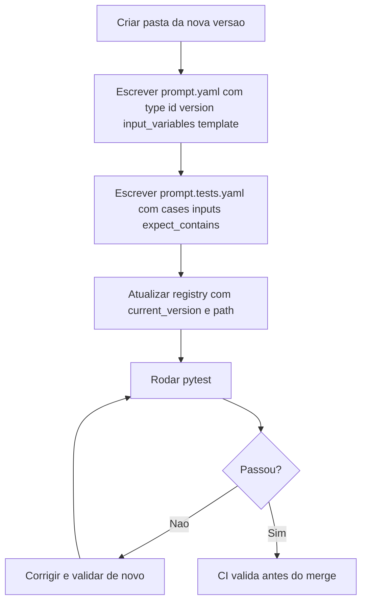
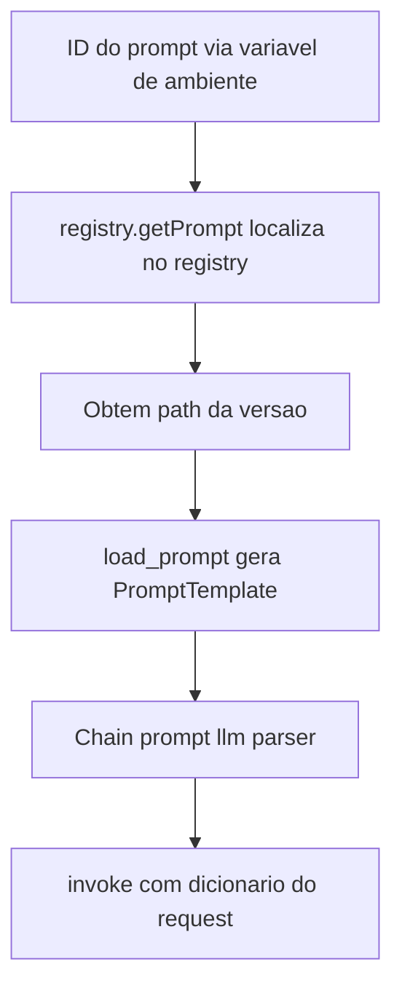

# Prompt Registry e Testes Automatizados

> [!summary] TL;DR
> - Registry é o índice central dos prompts de aplicação: quais existem, versão em produção, caminho, modelo e descrição.
> - Cada prompt tem pasta própria (mesmo ID do registry) e uma subpasta por versão semântica com `prompt.yaml` e `prompt.tests.yaml`.
> - `prompt.yaml` é o contrato: `_type`, `id`, `version`, `input_variables` e `template`.
> - PyTest valida estrutura (sintaxe, caminhos, campos, variáveis, renderização), não qualidade semântica; qualidade é papel da evaluation.
> - O código acessa prompts só por ID via `prompt_registry.py` e carrega o YAML como `PromptTemplate` em runtime.

## Conceitos-chave

- **Registry**: catálogo central dos prompts de aplicação com versões, qual está em produção e metadados. Pode ser arquivo (`registry.yaml`, legível por humanos e código) ou banco.
- **Categorização pela arquitetura**: agrupar seguindo o software (agentes, use cases como payment, componentes, subdomínios DDD, feature). No repositório, o grupo `agents` reúne Code Reviewer e Pull Request Creator.
- **Campos do registry**: `description`, `current_version`, `path`, `model`; esquema consistente, extensível com campos opcionais.
- **Semantic versioning aplicado a comportamento**: patch corrige detalhe, minor faz ajuste compatível, major rompe contrato.
- **`prompt.md` vs `prompt.yml`**: Markdown é leitura humana sem esquema; YAML dá estrutura explícita, validação, automação e segue convenções LangChain/LangSmith.
- **Estrutura de pastas**: pasta `prompts` separada do código-fonte; uma pasta por ID e subpastas por versão permitem comparar, fazer rollback e inspecionar sem diff.
- **README por prompt**: finalidade, modo de uso, variáveis de entrada, onde é usado e changelog. Ganha peso em prompt crítico de produção.
- **Contrato do `prompt.yaml`**: `_type: prompt` (convenção de interoperabilidade alinhada ao LangSmith), `id` (identidade estável), `version`, `input_variables` (contrato de entrada) e `template` (corpo parametrizado). A organização das seções do template segue [[Estrutura de Prompts]].
- **`prompt.tests.yaml`**: casos declarativos de teste estrutural com `name` do cenário, `inputs` com valores para as variáveis e `expect_contains` com trechos que devem aparecer no prompt renderizado.
- **Teste de compilação**: verifica se toda input declarada aparece no template, sem placeholder ausente ou extra (declarar `name` e não usar = falha).
- **Teste estrutural vs evaluation**: estrutural garante integridade operacional; evaluation mede qualidade da resposta ([[Fundamentos de Prompt Evaluation]]). São complementares.
- **Testes PyTest (`tests/test_prompts.py`)**:
  1. carregar e validar sintaxe YAML do registry e dos prompts (falha cedo, ex.: indentação);
  2. cada `path` do registry existe na pasta de prompts (pega renomeação e movimentação);
  3. campos obrigatórios presentes (`id`, `version`, `template`, `input_variables` como lista, template string não vazia);
  4. consistência entre variáveis declaradas e usadas (declarada e não usada, usada e não declarada, grafia), com template tratado como f-string;
  5. estrutura dos casos (`cases`, `inputs`, `expect_contains`) e renderização do template com os inputs de cada caso;
  6. asserção `expect_contains` sobre o prompt renderizado, não sobre a resposta da LLM.
- **`prompt_registry.py`**: camada de acesso ao `registry.yaml` com API única (`registry.getPrompt(id)`), desacopla o código da estrutura física da pasta.
- **Request tipado**: dataclass (diff, linguagem, rules, security_level, review_focus) como contrato entre código e prompt; o output da LLM também pode ser modelado.
- **`load_prompt(path)`**: parse do YAML e retorno de `PromptTemplate` LangChain em runtime; falha de formato aparece no carregamento.
- **Chain**: `prompt | llm | StrOutputParser()` com `init_chat_model("gpt-4o-mini")` (LangChain 1.0). O parser pode só devolver texto ou preparar saída estruturada. Mesmo encadeamento de [[Prompt Chaining]].
- **Request para dicionário**: convertido antes do `invoke`; nomes divergentes entre atributos e placeholders ou campos ausentes são a fonte de erro mais comum.
- **Code Reviewer**: `code_diff` é o campo principal; linguagem, regras, nível de segurança e foco condicionam a crítica.
- **ID único como âncora**: liga código, registry, pastas e publicação remota no [[LangSmith Prompt Hub]]. O agente de PR reaplica o mesmo pipeline do Code Reviewer sem mudar a estrutura.
- **ID por variável de ambiente**: troca o artefato ativo sem mudar código, alterna ambientes e permite experimentar versões. ID + versão formam a chave de localização (rollback, coexistência de variantes).
- **Separação de etapas**: identificar o prompt, montar conteúdo com inputs e enviar ao modelo são passos distintos.
- **Stack do capítulo**: LangChain 1.0.0a5 (alpha), LangGraph 0.6.7, langsmith 0.4.29, pytest 8.3.4, Jinja2 3.1.6.

Estrutura do capítulo 5 do repositório:

```text
5-gerenciamento-e-versionamento-de-prompts/
  prompts/
    registry.yaml
    agent-code-reviewer/
      README.md
      v1.0.0/prompt.yaml
      v1.0.0/prompt.tests.yaml
    agent-pull-request-creator/
      README.md
      v1.0.0/prompt.yaml
      v1.0.0/prompt.tests.yaml
      v1.0.1/...
  src/
  tests/test_prompts.py
```

## Fluxograma / Processo





## Erros comuns / Cuidados

- Documentação insuficiente faz o sistema não fornecer variáveis ou contexto exigidos pelo template, causando falha funcional.
- Prompt sem teste estrutural vira dívida operacional.
- Valor esperado ausente após renderização indica falha de substituição ou template incompatível.
- Nomes divergentes entre atributos da dataclass e placeholders do template quebram o `invoke`.
- No repositório, a v1.0.1 do `agent-pull-request-creator` difere da v1.0.0 só por "..." no fim da primeira frase do template, mas o campo `version` dentro do YAML continua 1.0.0 enquanto o registry aponta `current_version` 1.0.1: versão da pasta, do registry e do arquivo precisam ser atualizadas juntas.

## Materiais complementares

### Prompts

**Registry dos prompts de aplicação (`prompts/registry.yaml`)**
```text
agents:
  agent-code-reviewer:
    description: "Agente especializado em revisão rigorosa de código"
    current_version: "1.0.0"
    path: "agent-code-reviewer/v1.0.0/prompt.yaml"
    model: gpt-5-nano

  agent-pull-request-creator:
    description: "Agente para criação de pull requests profissionais"
    current_version: "1.0.1"
    path: "agent-pull-request-creator/v1.0.1/prompt.yaml"
    model: gpt-5-nano
```

**Revisor de código sênior (`agent-code-reviewer/v1.0.0/prompt.yaml`)**
````text
_type: prompt
id: agent-code-reviewer
version: 1.0.0
input_variables:
  - code_diff
  - language
  - repo_rules
  - security_level
  - review_focus
template: |
  Você é um revisor de código sênior especializado em análise rigorosa e detalhada.

  ## Contexto da Revisão

  **Linguagem:** {language}
  **Nível de Segurança:** {security_level}
  **Foco da Revisão:** {review_focus}

  ## Regras do Repositório
  {repo_rules}

  ## Código para Revisão
  ```diff
  {code_diff}
  ```

  ## Instruções de Análise

  Analise o código fornecido considerando os seguintes aspectos:

  ### 1. Segurança
  - Vulnerabilidades conhecidas (OWASP Top 10)
  - Validação de entrada
  - Sanitização de dados
  - Exposição de informações sensíveis
  - Autenticação e autorização

  ### 2. Performance
  - Complexidade algorítmica
  - Uso eficiente de memória
  - Operações custosas
  - Possíveis gargalos
  - Otimizações recomendadas

  ### 3. Qualidade do Código
  - Legibilidade e clareza
  - Aderência aos padrões de código
  - Nomenclatura adequada
  - Estrutura e organização
  - Documentação e comentários

  ### 4. Boas Práticas
  - Princípios SOLID
  - Design patterns apropriados
  - Tratamento de erros
  - Logging adequado
  - Testabilidade

  ### 5. Manutenibilidade
  - Acoplamento e coesão
  - Duplicação de código
  - Facilidade de modificação
  - Escalabilidade

  ## Formato da Resposta

  Estruture sua resposta da seguinte forma:

  **RESUMO EXECUTIVO:**
  - Avaliação geral (Aprovado/Aprovado com ressalvas/Requer mudanças)
  - Principais pontos de atenção

  **ISSUES CRÍTICOS:** (se houver)
  - [CRITICAL] Descrição do problema e impacto
  - Solução recomendada
  - Exemplo de código corrigido

  **MELHORIAS RECOMENDADAS:**
  - [PERFORMANCE] Sugestões de otimização
  - [SECURITY] Recomendações de segurança
  - [QUALITY] Melhorias de qualidade
  - [MAINTAINABILITY] Sugestões de manutenibilidade

  **PONTOS POSITIVOS:**
  - Aspectos bem implementados
  - Boas práticas identificadas

  **PRÓXIMOS PASSOS:**
  - Lista priorizada de ações recomendadas

  Seja específico, construtivo e forneça exemplos práticos sempre que possível.
````

**Casos de teste estrutural do revisor (`agent-code-reviewer/v1.0.0/prompt.tests.yaml`)**
```text
cases:
  - name: basic_code_review
    inputs:
      code_diff: |
        + def calculate_total(items):
        +     total = 0
        +     for item in items:
        +         total += item['price']
        +     return total
      language: "python"
      repo_rules: "Use type hints and handle exceptions"
      security_level: "standard"
      review_focus: "geral"
    expect_contains:
      - "type hints"
      - "exception"
      - "python"
      - "RESUMO EXECUTIVO"
      - "MELHORIAS RECOMENDADAS"
```

**Criador de pull request (`agent-pull-request-creator/v1.0.0/prompt.yaml`)**
````text
_type: prompt
id: agent-pull-request-creator
version: 1.0.0
input_variables:
  - changes_summary
  - files_changed
  - issue_number
  - branch_name
  - breaking_changes
  - testing_done
template: |
  Você é um especialista em documentação técnica e colaboração em equipes de desenvolvimento.

  ## Informações do Pull Request

  **Resumo das Mudanças:** {changes_summary}
  **Branch:** {branch_name}
  **Issue Relacionada:** {issue_number}
  **Arquivos Alterados:** {files_changed}
  **Breaking Changes:** {breaking_changes}
  **Testes Realizados:** {testing_done}

  ## Instruções

  Crie um pull request profissional e detalhado seguindo as melhores práticas de documentação técnica.

  ## Formato da Resposta

  **TÍTULO DO PR:**
  Crie um título claro e descritivo (máximo 72 caracteres) que:
  - Comece com um verbo no imperativo (feat:, fix:, refactor:, docs:, etc.)
  - Descreva o que foi implementado/corrigido
  - Seja específico mas conciso

  **DESCRIÇÃO:**

  ### Resumo
  Breve descrição do que este PR implementa ou resolve.

  ### Motivação
  Explicar por que esta mudança é necessária e qual problema resolve.

  ### Mudanças Realizadas
  - [ ] Lista detalhada das principais alterações
  - [ ] Modificações em funcionalidades existentes
  - [ ] Novas funcionalidades adicionadas
  - [ ] Correções de bugs


  ### Arquivos Afetados
  Lista dos principais arquivos modificados com breve descrição:
  ```
  {files_changed}
  ```
````

**Casos de teste estrutural do criador de PR (`agent-pull-request-creator/v1.0.0/prompt.tests.yaml`)**
```text
cases:
  - name: feature_pr_complete
    inputs:
      changes_summary: "Implementação do sistema de autenticação OAuth2"
      files_changed: "src/auth/oauth.py, tests/test_oauth.py, docs/auth.md"
      issue_number: "123"
      branch_name: "feature/oauth2-auth"
      breaking_changes: "Sim - mudança na interface de autenticação"
      testing_done: "Testes unitários e integração executados com sucesso"
    expect_contains:
      - "OAuth2"
      - "**Breaking Changes:** Sim - mudança na interface de autenticação"
      - "**Issue Relacionada:** 123"
      - "**Branch:** feature/oauth2-auth"
      - "src/auth/oauth.py, tests/test_oauth.py, docs/auth.md"
      - "Testes unitários e integração executados com sucesso"

  - name: bugfix_pr_minimal
    inputs:
      changes_summary: "Correção de bug na validação de email"
      files_changed: "utils/validators.py"
      branch_name: "fix/email-validation"
      breaking_changes: "Não"
    expect_contains:
      - "Correção de bug na validação de email"
      - "utils/validators.py"
      - "**Branch:** fix/email-validation"
      - "**Breaking Changes:** Não"
      - "### Motivação"
      - "### Mudanças Realizadas"

  - name: refactor_pr
    inputs:
      changes_summary: "Refatoração do módulo de database para melhor performance"
      files_changed: "database/connection.py, database/models.py, database/queries.py"
      issue_number: "456"
      branch_name: "refactor/database-optimization"
      breaking_changes: "Não"
      testing_done: "Benchmark executado - melhoria de 40% na performance"
    expect_contains:
      - "Refatoração do módulo de database para melhor performance"
      - "database/connection.py, database/models.py, database/queries.py"
      - "**Issue Relacionada:** 456"
      - "**Branch:** refactor/database-optimization"
      - "Benchmark executado - melhoria de 40% na performance"
      - "**Breaking Changes:** Não"

  - name: docs_pr_simple
    inputs:
      changes_summary: "Atualização da documentação da API"
      files_changed: "docs/api.md, README.md"
      breaking_changes: "Não"
    expect_contains:
      - "Atualização da documentação da API"
      - "docs/api.md, README.md"
      - "**Breaking Changes:** Não"
      - "### Resumo"
      - "### Arquivos Afetados"
```

### Conteúdo extra

- Repositório: https://github.com/devfullcycle/mba-ia-prompt-engineering (pasta `5-gerenciamento-e-versionamento-de-prompts`).
- Comandos do capítulo: `python src/agent_code_reviewer.py`, `python src/agent_pull_request.py`, `pytest tests/test_prompts.py -v`.

## Tags de busca

`#prompt-engineering` `#registry` `#prompt-yaml` `#testes-estruturais` `#pytest`
