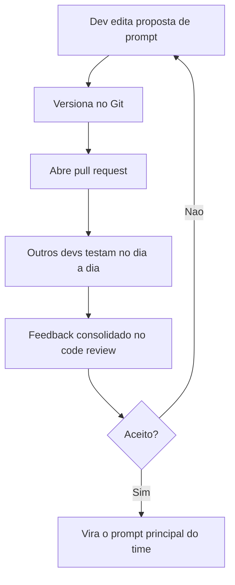
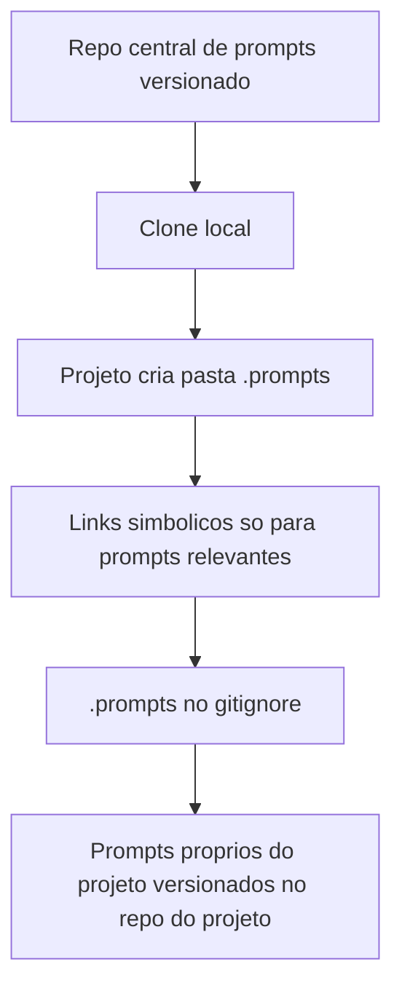

# Versionamento de Prompts em Equipe

> [!summary] TL;DR
> - Mudar um prompt muda comportamento funcional; versionar responde o que mudou, quando e com que efeito.
> - Prompts de produtividade (uso diário do dev) pedem gestão flexível; prompts de aplicação equivalem a regra de negócio e pedem controle rigoroso.
> - Prompt compartilhado segue o fluxo de software: Git, pull request e code review antes de virar referência do time.
> - Repositório central de prompts + links simbólicos numa pasta `.prompts` expõe só o necessário em cada projeto, com fonte única.
> - README como índice categorizado, `documento.md` por prompt e changelog curto tornam a biblioteca descobrível.

## Conceitos-chave

- **Prompt como comportamento**: em aplicação com IA, o prompt define tom, formato, critérios de decisão, nível de detalhe e restrições da saída. Versionar reduz regressões comportamentais e permite auditoria, rollback, comparação e saber qual versão estava em produção.
- **Prompts de produtividade**: usados pelo dev no dia a dia (rascunhos, revisão, estruturar ideias). Impacto restrito, gestão mais flexível.
- **Prompts de aplicação**: incorporados ao sistema, exigem histórico, controle de mudanças e critérios rigorosos. Ficam num registry próprio, ver [[Prompt Registry e Testes Automatizados]].
- **Prompt como software**: Git para versões, PR para propor mudança, code review antes de virar o prompt principal do time.
- **Dependência de modelo**: o mesmo prompt varia conforme o modelo; registrar com quais modelos foi testado.
- **Avaliação subjetiva**: prompt de produtividade raramente resolve em one shot e não tem métrica binária simples. [[Fundamentos de Prompt Evaluation]] apoia, mas não substitui julgamento técnico.
- **Governança antes de armazenamento**: definir como uma mudança é proposta e aceita vem antes de decidir onde e como guardar.
- **Repositório central**: biblioteca de prompts de uso geral (do time ou pessoal) evita duplicação e perda da noção de qual é a melhor versão.
- **Problema de copiar a biblioteca inteira**: ferramentas de IA leem guidelines e comandos conflitantes (TypeScript, Go, Python) e geram ruído.
- **Pasta `.prompts` com links simbólicos**: cada projeto aponta só para os prompts relevantes da biblioteca, mantendo fonte única e isolamento físico entre projeto e biblioteca. Vai no `.gitignore`, porque os links dependem de caminhos da máquina local.
- **Prompts persistentes**: Agents.md, Claude.md e equivalentes são prompts e seguem a mesma disciplina de versionamento.
- **Genérico vs específico**: prompts coringa ficam na biblioteca central; Agents.md, comandos e workflows do projeto (como os de [[Prompts de Agentes Especialistas]]) ficam versionados no próprio repositório do projeto.
- **README como índice**: lista o que existe, em qual categoria e quando usar.
- **`documento.md` por prompt**: fica ao lado do raw (`prompt.md` ou `.yml`) com nome, link para a versão plain, objetivo, modelos testados e observações.
- **Changelog curto**: últimas ~3 mudanças em linguagem humana, pode ser mantido com IA, complementa o diff.
- **Categorias da biblioteca**:
  - exploração e planejamento: análise de codebase, vulnerabilidades, leitura de guidelines, planejamento de features;
  - documentação: DR, RFC, PRD, design docs;
  - implementação: workflows de dev, testes automatizados, correção de bugs, refatoração, LLM as a judge;
  - especialização por linguagem ou framework: Go, Spring, Laravel, LangGraph, LangChain, como camada extra de constraints e guidelines;
  - infraestrutura: Dockerfile, Docker Compose, Kubernetes, Terraform, CI/CD;
  - utilidades: mensagem de commit, PR a partir de template, code review.
- **Composição genérico + especialização**: prompt da tarefa (gerar testes) combinado com prompt de especialização (como fazer em Go) evita prompt vago ou hiperlocal.
- **Taxonomia como governança**: a categorização é explícita e própria do time, não universal.
- **Autoria vs desenvolvimento**: produto, operação e especialistas de domínio podem escrever prompts; o dev integra, executa e protege. Plataformas externas como o [[LangSmith Prompt Hub]] atendem quem não usa Git.
- **Ferramenta é detalhe**: Git, Markdown, YAML, registry local ou remoto e LangSmith são implementação; organização, histórico e referência estável são a base, adotadas desde o dia zero.
- **Limite da gestão**: gestão de prompt não cobre caching, latência e velocidade, que são outra camada (ver [[Prompt Caching e Batch Prompting]]).

## Fluxograma / Processo

## Erros comuns / Cuidados

- Copiar o repositório inteiro de prompts para cada projeto: a IA lê instruções conflitantes de outras stacks.
- Versionar `.prompts` com links simbólicos: quebra em outra máquina.
- Tratar prompt de aplicação com a mesma flexibilidade do prompt de produtividade.
- Escolher ferramenta antes de definir o processo de mudança.

## Tags de busca

`#prompt-engineering` `#versionamento` `#git` `#biblioteca-de-prompts`
