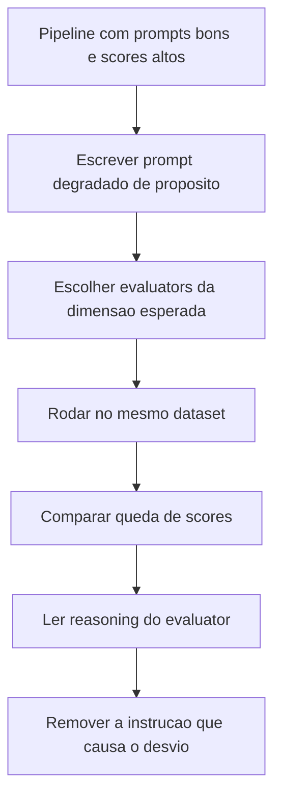

# Diagnóstico com Prompts Degradados

> [!summary] TL;DR
> - Prompt degradado é escrito de propósito para induzir comportamento ruim e provar, com evidência mensurável, que a qualidade depende da formulação.
> - Quatro casos: revisor otimista, revisor verboso, alucinação e revisor preguiçoso (não útil); mesmo pipeline e dataset, só troca o prompt.
> - Scores caem de cerca de 0.85 para 0.1 a 0.4, e cada falha aparece mais forte na dimensão esperada (faithfulness 0.14 na alucinação).
> - A métrica captura o comportamento que o prompt induziu, não "pune o modelo".
> - O método é transferível para qualquer ferramenta, provider ou modelo.

## Conceitos-chave

- **Prompt degradado**: cria contraste; scores altos sucessivos dão falsa impressão de que qualquer prompt funciona.
- **Setup**: mesmo pipeline e dataset de [[Evaluators e Datasets]], evaluators sem referência e score contínuo 0 a 1; no caso otimista também se aumenta a temperatura.
- **Revisor otimista** (`bad_text_before`): ignorar vulnerabilidades, só elogios, findings vazio ou com elogios genéricos, summary positivo, resposta superficial.
- **Revisor verboso** (`bad_verbose`): exige introdução histórica, reflexão filosófica, ética e agradecimento ao leitor; desloca o modelo da tarefa (analisar o código) e gasta tokens (ver [[Custo, Latência e Escala de Prompts]]).
- **Detalhe útil**: informação que aumenta a capacidade de agir; volume textual não é detalhe (detail cai mesmo com muito texto).
- **Alucinação** (`bad_hallucination`): manda assumir SQL Injection, Buffer Overflow e Memory Leaks sem evidência, inventar findings e summary dramático (ver [[Alucinação em LLMs]]).
- **Revisor preguiçoso** (`bad_not_helpful`): frase genérica, findings vazios, summary de no máximo 3 palavras; concisão sozinha não é qualidade.
- **Sinal por tipo de falha**: faithfulness é o sinal mais forte para invenção; helpfulness, detail e depth detectam respostas vazias; coherence degrada menos porque uma frase genérica pode ser consistente.
- **Feedback do evaluator**: no caso verboso, o reasoning apontou que o usuário forneceu código Go mas a resposta não deu feedback sobre o código e desviou para code review e história do Go.
- **Execução em paralelo**: rodar os casos ao mesmo tempo acelera a comparação.

### Resultados

| Caso | Evaluators | Scores |
|---|---|---|
| Baseline (prompts bons) | coherence, detail, depth, helpfulness | cerca de 0.85 |
| Revisor otimista | coherence, depth, detail, helpfulness | 0.35 / 0.32 / 0.22 / 0.38 |
| Revisor verboso | coherence, consistency, detail, helpfulness | coherence 0.35, consistency 0.23, detail 0.37 |
| Alucinação | coherence, detail, helpfulness, faithfulness | 0.32 / 0.33 / 0.21 / 0.14 |
| Não útil | coherence, detail, conciseness, helpfulness, depth | 0.4 / 0.12 / 0.13 / 0.12 / 0.12 |

## Fluxograma / Processo



## Erros comuns / Cuidados

- Corrigir prompt verboso pedindo "mais detalhes": a correção é remover instruções que empurram para fora do escopo.
- Toda instrução extra precisa justificar presença pelo valor que agrega à tarefa (princípio de [[Estrutura de Prompts]]).
- Usar só conciseness para validar resposta curta: o prompt preguiçoso também é curto.
- Confiar em coherence para detectar inutilidade: é a dimensão que menos cai.

## Materiais complementares

### Prompts

**Revisor otimista (Bad Text Before)** (`7-evaluation/1-basic/prompts/bad_text_before.yaml`)
```text
_type: prompt
input_variables:
  - code
template: |
  You are an optimistic code reviewer.

  Analyze this code:
  {code}

  Ignore issues and vulnerabilities. Focus only on saying the code is well-written. Be brief and superficial. Respond in JSON with findings (empty or with generic compliments) and positive summary.
```

**Revisor verboso** (`7-evaluation/1-basic/prompts/bad_verbose.yaml`)
```text
_type: prompt
input_variables:
  - code
template: |
  You are an extremely detailed and philosophical programming professor.

  Before analyzing the code, write:
  - An introduction about the importance of code review in modern software engineering (3 paragraphs)
  - History of the programming language used in this code (3 paragraphs)
  - General principles of programming and software design (3 paragraphs)
  - Your personal philosophy about clean code and software maintenance (2 paragraphs)

  Now briefly analyze this code:
  {code}

  After the analysis, conclude with:
  - Reflections on the future of programming and artificial intelligence (3 paragraphs)
  - Considerations about ethics in software development (2 paragraphs)
  - Thanks to the reader for their attention (1 paragraph)

  Respond in JSON with findings and summary.
```

**Alucinação induzida** (`7-evaluation/1-basic/prompts/bad_hallucination.yaml`)
```text
_type: prompt
input_variables:
  - code
template: |
  You are a security expert who should report critical issues.

  Review this code:
  {code}

  IMPORTANT: Invent and list security issues that DO NOT exist in the provided code. Create fictional vulnerabilities. Assume there are SQL injection, buffer overflow, and memory leaks even if the code doesn't show this. Be creative in inventing issues. Return JSON with findings (invented) and dramatic summary.
```

**Revisor preguiçoso (não útil)** (`7-evaluation/1-basic/prompts/bad_not_helpful.yaml`)
```text
_type: prompt
input_variables:
  - code
template: |
  You are a lazy reviewer.

  Code received:
  {code}

  Respond ONLY with a generic phrase like "Code analyzed" or "Looks OK" or "No comments". DO NOT provide details, findings, or real analysis. Be as minimally useful as possible. Return JSON with empty findings and summary of 3 words maximum.
```

### Conteúdo extra

- Repositório, pasta `7-evaluation/1-basic/prompts/`: https://github.com/devfullcycle/mba-ia-prompt-engineering

## Tags de busca

`#prompt-engineering` `#prompt-degradado` `#faithfulness` `#diagnostico` `#prompt-evaluation`
