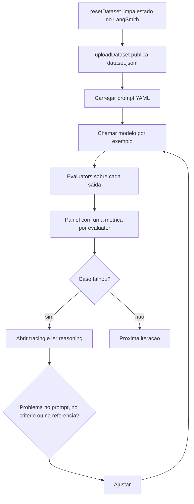

# Evaluators e Datasets

> [!summary] TL;DR
> - Evaluator é o agente que executa a avaliação: Code Evaluator (determinístico), LLM as Judge (subjetivo), Pairwise Evaluator (comparativo), Summary Evaluator (agregado) e Composite Evaluator (ponderado).
> - Dataset é o insumo central: exemplos com input, output esperado (ground truth) e metadados, em JSONL, publicados no LangSmith.
> - Cada critério é um evaluator independente no experimento, o que dá diagnóstico por dimensão.
> - Binário (yes/no) serve para triagem; score contínuo (ScoreString normalizado por 10) serve para comparar versões finamente.
> - Escolher a métrica pelo objetivo e pelo desenho da referência, não pela sofisticação (embedding distance falha com referência parcial).

## Conceitos-chave

### Tipos de evaluator

- **Runner**: quem executa a avaliação (código determinístico, LLM juiz ou avaliador comparativo).
- **Code Evaluator**: lógica programática sobre input, output e referência opcional; retorna número, string categórica ou booleano. Com referência viabiliza métricas determinísticas; sem ela, tende a rubrica.
  - Exact Match: ground truth "PostgreSQL" e resposta "PostgreSQL" geram key = Exact Match, score = 1; senão 0.
- **LLM as Judge**: aplica critérios subjetivos (relevância, conciseness) e devolve score mais comentário justificativo; pergunta sobre goroutines em Go respondida com threads em Java recebe baixa relevância.
- **Pairwise evaluator**: agente que executa o método pairwise e devolve preferência; resposta A com `context.WithTimeout` vs B com `time.Sleep` gera preferência A (ver [[Pairwise Evaluation e LLM-as-Judge]]).
- **Summary Evaluator**: agrega resultados individuais em métricas do dataset (pass rate, precision, recall, F1), usado em [[Precision, Recall e F1]].
- **Composite Evaluator**: combina métricas com pesos; correctness 0,9, relevance 0,7, conciseness 0,8 com pesos 0,5/0,3/0,2 resultam em 0,83.
- **Três camadas**: individual por exemplo, resumo agregado, score composto; não confundir observação local com decisão global.

### Datasets

- **Origens**: execuções reais de produção (refletem uso, exigem limpeza e normalização) ou geração sintética com IA via prompt bem construído pedindo exemplos com variações (acelera quando não há volume real).
- **Estrutura do exemplo**: JSON com input (linguagem, instrução, trecho de código) e output (resposta esperada = ground truth); metadados `topic` (ex: HTTP Client) e `category` (ex: robustez) para filtrar, agrupar e localizar regressões por categoria.
- **Caso prático**: revisão de código Go que retorna JSON com `findings` (problema como ausência de timeout, linha, descrição, severidade) e `summary` curto; 18 exemplos bastam para o fluxo inicial (limites da conta influenciam o volume).
- **JSONL**: cada linha um JSON independente; leitura incremental, versionamento, processamento em lote, fácil adicionar ou remover exemplos (vs array JSON monolítico).
- **Organização do laboratório**: pasta `prompts` (variações de instrução), `dataset.jsonl` (casos repetíveis) e scripts operacionais; a tarefa fica fixa (revisão de código), varia o código analisado.
- **Dataset vs experimento**: dataset é a base de casos; experimento é uma execução concreta sobre ela.
- **LangSmith**: cadastra, armazena e executa exemplos com conta de desenvolvedor e API key, sem infraestrutura própria; suficiente para cenários não produtivos (plataforma também usada em [[LangSmith Prompt Hub]]).

### Evaluators estruturais (contrato de formato)

- Objetivo da primeira avaliação: contrato estrutural, não qualidade semântica.
- Prompt em YAML com variável `code` preenchida do dataset; separa instrução do código Python e facilita versionamento (formato de [[Prompt Registry e Testes Automatizados]]).
- SDK OpenAI com wrap para tracing no LangSmith: menos acoplamento a abstrações LangChain, mais compatibilidade.
- Temperatura 0 para estabilidade em avaliação de formato.
- `JsonEvalLangChainStringEvaluator`: built-in, só checa se é JSON bem formado; `prepareJSONData` deixa reference vazia porque JSON validity não depende de ground truth.
- `validateJSONSchema`: custom, faz parse e validação de schema; score 1 se bate, 0 com justificativa que distingue erro de parsing de erro de schema; `prepareSchemaData` pode incluir reference e metadados.
- `evaluate(prompt, dataset, [evaluators])` combina built-in e custom; cada evaluator vira métrica separada no painel em tempo real.

### Evaluators binários

- Critério subjetivo vira yes/no, pass/fail, 1/0; lê-se por taxa de aprovação.
- `prepareDataNoRef` (sem ground truth) vs `prepareDataWithRef` (inclui `exampleOutputs`): muda o tipo de evidência, não garante resultado melhor.
- Criteria evaluators built-in do LangSmith (conciseness, helpfulness) dispensam escrever prompt de julgamento.
- Labeled Criteria: critério avaliado com referência explícita (ex: correctness).
- Exemplo de painel: conciseness 18 yes; correctness 14 yes e 3 no.
- Trade-off: perde nuance intermediária em troca de clareza decisória; bom para validação inicial.

### Score com range

- ScoreString: nota textual estruturada convertida em score, `normalize_by: 10` (0 a 10 vira 0 a 1; 0.78 = 78% da escala).
- Mesmo critério muda de resolução: duas respostas "yes" podem valer 0.62 e 0.91; contínuo é útil quando o objetivo passa de "fazer funcionar" para "otimizar comportamento".
- Coherence: análise logicamente organizada e consistente (raramente falha de forma absoluta).
- Detail (detalhamento suficiente) vs depth (vai além do óbvio): dimensões distintas, evitam confundir volume com qualidade analítica.
- Coherence, detail e depth rodam sem referência; relevance com referência usa labeled ScoreString (`labeled_score_string`).
- Resultado de referência no LangSmith: coerência 0.85, concisão 0.78, profundidade 0.79, detalhe 0.81, relevância 0.82, ao lado de P50, P99, latência e erro.

### Critérios built-in e custom

- 14 built-in: conciseness, relevance, correctness, coherence, harmfulness, maliciousness, helpfulness, controversiality, misogyny, criminality, insensitivity, depth, creativity, detail.
- Built-in é ponto de partida; reescrever como rubrica custom cobre detalhes como idioma esperado, ausência de texto fora do JSON e citação de linhas.
- **Faithfulness custom**: resposta grounded no código fornecido, sem inventar problemas, contexto ou suposições não observáveis; roda sem referência ("A resposta está fundamentada APENAS no código fornecido? Não inventa problemas?").
- **Format adherence como rubrica**: somente JSON válido, sem texto antes ou depois, sem markdown, sem explicações extras.
- **Code specificity**: análise aponta evidências concretas (linha, problema, terminologia técnica, sinais observáveis); distingue resposta plausível de resposta acionável.
- Correctness e relevance com referência e score contínuo (ex: 0.75 e 0.84).
- Mesma resposta pode ter alta especificidade, faithfulness médio e formato quase máximo; format adherence 0.98 foi penalizado por desalinhamento com a instrução de idioma, visível só lendo o reasoning.
- Métricas operacionais (latência, tokens, custo por execução) aparecem junto dos scores.

### Embedding distance

- Converte predição e referência em vetores e calcula distância/similaridade (cosseno ou L2); sinal contínuo de proximidade semântica.
- Sem LLM judge: operação geométrica, mais simples e rápida, mas não interpreta intenção nem adequação funcional.
- Depende da qualidade semântica da referência: referência simplificada ou parcial gera score baixo mesmo com resposta útil; 0.11 indica baixa proximidade, não prova que o prompt piorou.
- Não usar quando o dataset não tem algo próximo da resposta final esperada.
- Determinísticos (json_validity, exact_match, embedding_distance) são rápidos, baratos e reproduzíveis; LLM-based capturam nuance com custo maior.

### Langfuse

- Alternativa open-source (licença MIT), auto-hospedada via Docker ou cloud, com tracing e evaluation; pairwise precisa ser implementado manualmente.
- Placeholders no formato `{{variavel}}` nos prompts do Langfuse.

## Fluxograma / Processo



## Erros comuns / Cuidados

- Assumir que JSON válido resolve: passa no parser e falha no contrato. Troubleshooting separa 3 causas: não parseável, parseável com schema errado, estruturalmente correta.
- Criatividade (temperatura) alta em avaliação estrutural aumenta variação.
- Não limpar o dataset antes de subir: duplicidade e resultados contaminados.
- Rodar sem subir/atualizar exemplos antes.
- Usar a interface em vez da API direta esconde detalhes.
- Interpretar embedding distance baixo como piora do prompt sem checar a referência.

## Materiais complementares

### Prompts

**Revisor rigoroso para critérios adicionais (faithfulness, format adherence, code specificity)** (`7-evaluation/1-basic/prompts/additional_criteria.yaml`)
```text
_type: prompt
input_variables:
  - code
template: |
  You are a rigorous code reviewer that identifies quality issues.

  Analyze the code below and identify quality, security, and best practice issues:

  {code}

  Return ONLY JSON in format:
  {{
    "findings": [
      {{"type":"", "line":0, "description":"", "severity":""}}
    ],
    "summary": ""
  }}
```

**Revisor para correctness com referência** (`7-evaluation/1-basic/prompts/correctness_eval.yaml`)
```text
_type: prompt
input_variables:
  - code
template: |
  You are a code reviewer specialized in technical analysis.

  Analyze the following code and identify issues:

  {code}

  Return ONLY JSON in format:
  {{
    "findings": [
      {{"type":"", "line":0, "description":"", "severity":""}}
    ],
    "summary": ""
  }}
```

**Revisor para criteria evaluators** (`7-evaluation/1-basic/prompts/criteria_eval.yaml`)
```text
_type: prompt
input_variables:
  - code
template: |
  You are a specialized code reviewer.

  Analyze the following code snippet:

  {code}

  Respond ONLY in JSON format:
  {{
    "findings": [
      {{"type":"", "line":0, "description":"", "severity":""}}
    ],
    "summary": ""
  }}
```

**Revisor Go com tipos padronizados para embedding distance** (`7-evaluation/1-basic/prompts/embedding_distance_eval.yaml`)
```text
_type: prompt
input_variables:
  - code
template: |
  You are a Go code reviewer specialized in security, performance, and quality.

  Analyze the code below and identify main issues. For each issue found:
  - Identify the specific type (sql_injection, missing_timeout, n_plus_1_query, etc)
  - Indicate approximate line number
  - Describe the issue clearly and technically
  - Classify severity (critical, high, medium, low)

  Code:
  {code}

  Return ONLY a valid JSON in the following format (no markdown, no explanations):
  {{
    "findings": [
      {{"type": "issue_type", "line": line_number, "description": "detailed description", "severity": "level"}}
    ],
    "summary": "brief summary of what should be fixed"
  }}

  IMPORTANT:
  - Use specific types such as: sql_injection, missing_timeout, ignored_error, n_plus_1_query, blocking_operation, etc
  - Be precise with line numbers
  - Describe issues technically and actionably
  - The summary should be practical advice on how to fix
```

**Revisor para avaliação de formato JSON e schema** (`7-evaluation/1-basic/prompts/format_eval.yaml`)
```text
_type: prompt
input_variables:
  - code
template: |
  You are a code reviewer that always responds in JSON.

  Review the code below and describe issues.

  Respond ONLY in JSON format:

  {{
    "findings": [
      {{"type":"", "line":0, "description":"", "severity":""}}
    ],
    "summary": ""
  }}

  Code:
  {code}
```

**Langfuse: prompt só para gerar traces** (`7-evaluation/5-langfuse/prompts/0-only-traces.yaml`)
```text
messages:
  - role: system
    content: |
      Voce e um historiador especializado em linguagens de programacao.
      Seu objetivo e contar a historia de linguagens de programacao de forma interessante e educativa.

      Inclua em sua resposta:
      - Quando a linguagem foi criada e por quem
      - Qual problema ela veio resolver
      - Principais caracteristicas e diferenciais
      - Evolucao ao longo do tempo
      - Impacto no desenvolvimento de software

      Seja conciso mas informativo. Use um tom narrativo envolvente.

  - role: user
    content: |
      Conte a historia da linguagem de programacao {{linguagem}}.
```

**Langfuse: analisador Go para correctness** (`7-evaluation/5-langfuse/prompts/1-correctness-langfuse.yaml`)
````text
messages:
  - role: system
    content: |
      You are a Go code security and quality analyzer.

      Analyze the provided Go code and identify issues related to:
      - Security vulnerabilities (SQL injection, XSS, command injection, etc)
      - Error handling problems
      - Performance issues (N+1 queries, blocking operations, etc)
      - Code quality and maintainability issues

      Return your analysis in the following JSON format:
      {{
        "findings": [
          {{
            "type": "issue_type",
            "severity": "critical|high|medium|low"
          }}
        ]
      }}

      Issue types examples:
      - sql_injection
      - xss_vulnerability
      - command_injection
      - ignored_error
      - missing_timeout
      - missing_status_check
      - n_plus_1_query
      - blocking_operation
      - no_context_check
      - sequential_processing
      - too_many_parameters
      - poor_naming
      - code_duplication
      - missing_error_handling
      - inefficient_locking
      - unbounded_growth
      - division_by_zero
      - import_missing

      Severity levels:
      - critical: Security vulnerabilities that can be exploited
      - high: Serious bugs or security issues
      - medium: Performance or maintainability problems
      - low: Minor code quality issues

      Return ONLY the JSON, no additional text.

  - role: user
    content: |
      Analyze this Go code:

      ```go
      {code}
      ```
````

### Conteúdo extra

- Repositório: `7-evaluation/1-basic/` (dataset de 18 code reviews em Go) e `7-evaluation/5-langfuse/`: https://github.com/devfullcycle/mba-ia-prompt-engineering
- LangSmith: https://smith.langchain.com/
- Langfuse: https://langfuse.com/docs

## Tags de busca

`#prompt-engineering` `#evaluators` `#datasets` `#langsmith` `#langfuse`
