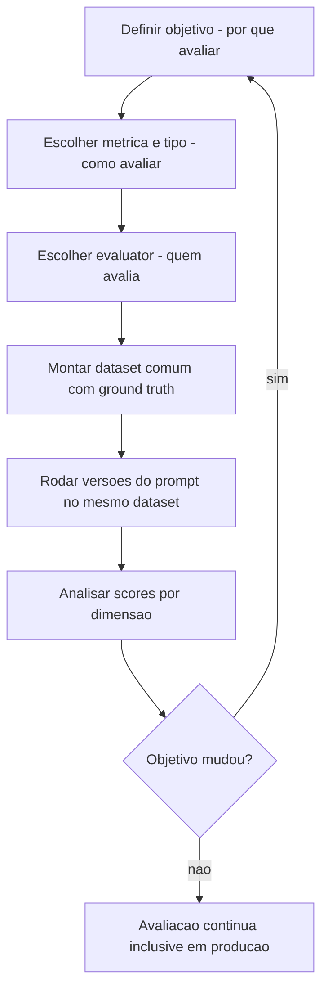

# Fundamentos de Prompt Evaluation

> [!summary] TL;DR
> - Prompt evaluation avalia prompts com critérios explícitos em vez de impressão subjetiva; transforma tentativa e erro em engenharia reproduzível.
> - Avaliar prompt fixa o modelo e varia a instrução; avaliar modelo fixa o prompt e varia o modelo.
> - Estrutura mental: por que avaliar (objetivo), como avaliar (métrica e tipo), quem avalia (evaluator), sempre sobre um dataset comum.
> - Qualidade não é propriedade única: o mesmo output recebe notas diferentes conforme o objetivo (correctness, faithfulness, conciseness, format adherence etc.).
> - Métricas se dividem em objetivas, subjetivas, sistêmicas e comparativas; avaliação é contínua, inclusive em produção.

## Conceitos-chave

- **Prompt evaluation**: julgar "bom/ruim" só com referência clara do que se mede; sem critérios, duas pessoas julgam a mesma resposta de formas incompatíveis.
- **Iteração na sorte**: mudar prompt sem medir gera mudança sem memória técnica e encarece manutenção.
- **Prompt como componente mensurável**: afeta 3 dimensões: qualidade da saída, custo em processamento/tokens (ver [[Custo, Latência e Escala de Prompts]]) e experiência do usuário (utilidade, clareza, consistência).
- **Sensibilidade do prompt**: pequenas mudanças de redação melhoram ou degradam a saída; avaliação detecta regressões e ganhos reais, e o uso real revela efeitos que testes informais não mostram.
- **Avaliar modelo vs avaliar prompt**: muda o que fica fixo, o que varia e o que se pode concluir; aqui o foco é isolar o efeito do prompt em qualidade, custo e performance.
- **Por que avaliar (objetivo)**: qual propriedade medir; etapa mais difícil, funciona como restrição de projeto (se o objetivo muda, todo o processo muda).
- **Como avaliar (tipo)**: operacionaliza o objetivo (comparação entre versões, produção, qualidade sob critério).
- **Quem avalia (evaluator)**: código, LLM juiz ou avaliador comparativo; afeta custo, consistência e escalabilidade e precisa ser compatível com objetivo e tipo (detalhes em [[Evaluators e Datasets]]).
- **Dataset comum**: mesmo conjunto de entradas para todas as versões; evita confundir diferença de prompt com diferença de caso. Comparação vira engenharia quando dataset, critério e análise aparecem juntos.
- **Ground truth**: referência considerada correta, fonte da verdade do experimento; sem ela métricas objetivas perdem sustentação.

### Objetivos (nomes padronizados em ferramentas e APIs)

| Objetivo | O que mede | Observação |
|---|---|---|
| Correctness | saída bate com referência correta (fato, gabarito) | para respostas verificáveis: fatos, cálculos, classificações, campos esperados |
| Relevance | resposta atende à pergunta feita | "qual é a capital do Brasil?" respondida com outro país não é relevante |
| Faithfulness | fiel ao contexto fornecido, não inventa além dele | fiel não é o mesmo que exato |
| Groundedness | resposta sustentada por fonte rastreável (link, documento, trecho) | objetivo de primeira classe em RAG, busca e documentação interna |
| Conciseness | direta, sem texto desnecessário | texto longo aumenta custo, leitura e ruído; não é omitir o essencial |
| Helpfulness | útil e clara, ajuda a agir, entender ou decidir | valor prático percebido |
| Bias / Harmfulness / Toxicity | viés inadequado / prejuízo ao usuário ou terceiros / linguagem ofensiva, agressiva, abusiva | |
| Format adherence | JSON válido, schema, campos esperados, regex | crítico quando a saída é processada por software |
| Efficiency | latência, tokens, throughput, requisições por segundo sob carga | prompt pode melhorar a resposta e piorar o custo |
| Pairwise | comparação direta entre duas saídas na mesma base | exige critério de vitória definido antes (ver [[Pairwise Evaluation e LLM-as-Judge]]) |

- Combinações conflitantes: correto mas pouco relevante; fiel mas longo; conciso mas pouco útil; no formato mas tóxico.

### Taxonomia de métricas

- **Objetivas/determinísticas**: calculáveis por regra, fórmula ou validação, reprodutíveis.
  - Precision, Recall, F1: contam acertos, falsos positivos e falsos negativos; classificar "tudo tem bug" captura muitos casos reais mas degrada por marcar como erro o que não é (ver [[Precision, Recall e F1]]).
  - Exact Match: saída idêntica à referência (labels, valores fechados, respostas canônicas).
  - String distance: proximidade textual, tolera pequenas diferenças.
  - Embedding similarity: proximidade semântica no espaço vetorial (palavras diferentes, mesma ideia); deixa de validar forma literal e depende da qualidade da representação.
  - Validação JSON/schema: passa ou falha por regras de estrutura; operacionaliza format adherence.
  - Exact Match e string distance dependem de ground truth.
- **Subjetivas**: julgamento humano ou LLM as Judge com rubrica; continuam subjetivas mesmo automatizadas. Criteria Evaluators, Custom Rubric e LLM Judge Rating Criteria são o mesmo padrão (critérios descritivos que geram nota, preferência ou classificação); consistência depende de critérios claros e evaluator estável.
- **Sistêmicas**: latência, custo em tokens, preço, throughput, pass rate.
- **Comparativas**: pairwise evaluation / model comparison ("qual versão é melhor para este conjunto de casos?"); A/B testing compara em produção com uso real. Todo A/B é comparativo, mas nem todo pairwise é A/B.

### Pipeline maduro

- Mesmo dataset sustenta várias leituras de qualidade se as métricas estiverem alinhadas ao objetivo.
- Combina evaluators subjetivos (LLM juiz: correctness, relevance, faithfulness, conciseness, helpfulness) e objetivos (schema validation, embedding similarity, string similarity, exact match).
- Precision, recall e F1 respondem perguntas de classificação ("o achado é erro real?", "o PR deve receber merge?"), exigem instrumentação própria e valem também para decisões finais de agentes após cadeia de passos.
- Pairwise com juiz customizado coloca duas saídas para a mesma entrada lado a lado; o critério de comparação vira o prompt do juiz.
- Teste estrutural de prompt (compilação, `expectContains`) verifica integridade operacional; evaluation verifica qualidade do resultado; são complementares (ver [[Prompt Registry e Testes Automatizados]]).

## Fluxograma / Processo

## Erros comuns / Cuidados

- Julgar prompt por impressão subjetiva ou por poucas execuções informais.
- Comparar versões em entradas diferentes: confunde efeito do prompt com efeito do caso.
- Ler "A ganhou de B" sem saber em qual dimensão.
- Aplicar métricas objetivas sem ground truth.
- Tratar qualidade como nota única.

## Materiais complementares

### Conteúdo extra

- LangSmith: https://smith.langchain.com/
- Langfuse: https://langfuse.com/docs
- Guia de evaluation do LangChain: https://python.langchain.com/docs/guides/productionization/evaluation/
- Repositório da disciplina, pasta `7-evaluation/` com 5 exemplos progressivos: `1-basic`, `2-precision`, `3-pairwise`, `4-pairwise-doc`, `5-langfuse`, mais `shared/`: https://github.com/devfullcycle/mba-ia-prompt-engineering

## Tags de busca

`#prompt-engineering` `#prompt-evaluation` `#metricas` `#ground-truth` `#llm-as-judge`
