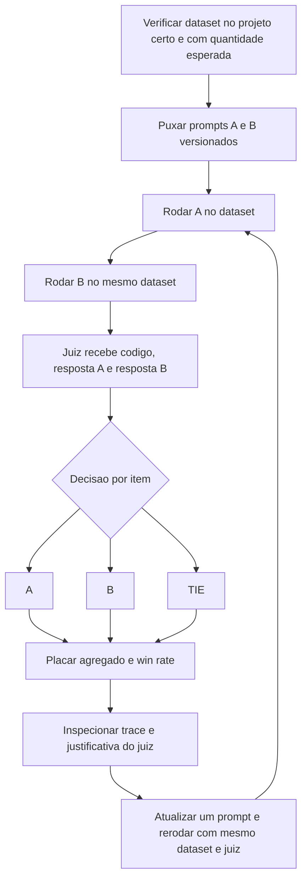

# Pairwise Evaluation e LLM-as-Judge

> [!summary] TL;DR
> - Pairwise evaluation é avaliação relativa sem ground truth absoluto: qual de duas respostas para o mesmo input é melhor segundo critério explícito.
> - LLM-as-Judge é um modelo adicional, árbitro imparcial, que recebe input original, resposta A e resposta B e devolve A, B ou TIE; o critério de vitória vira o prompt do juiz.
> - Experimento de code review: Security Expert V1 vs Performance Expert empata (5,5 x 4,5); Security Expert V2 (segurança + performance) vence por 8 x 2.
> - Pedir justificativa por categoria torna o julgamento auditável e explica por que um prompt vence (caso de documentação long-form).
> - Pairwise é offline e controlado; A/B testing é online com usuários reais; um não substitui o outro.

## Conceitos-chave

- **Pairwise evaluation vs Pairwise Evaluator**: método vs componente que executa e devolve preferência (nomenclatura do LangSmith, ver [[Evaluators e Datasets]]).
- **Critério explícito obrigatório**: o juiz não decide "qual gostou mais". "Como trabalhar com timeout em um HTTP request com Go": A usa `context.WithTimeout`, B usa `time.Sleep`, correctness escolhe A.
- **Custo**: 3 chamadas por item (opção 1, opção 2 e juiz).
- **Pairwise vs A/B testing**: pairwise é offline, controlado, julgado por avaliador; A/B é em produção com usuários reais e métricas de negócio. "Prompt A" e "Prompt B" aqui são rótulos de variantes offline.
- **Complemento a métricas de classificação**: útil quando várias respostas são aceitáveis mas uma é melhor, onde [[Precision, Recall e F1]] não discriminam.
- **LLM as a Judge**: modelo separado, não autoavaliação; recebe código-fonte original, resposta A e resposta B.
- **Tie**: resultado válido; evita ruído de vencedor artificial, e a frequência de ties indica se mudanças de prompt fazem diferença.
- **Win rate**: proporção de vitórias de cada variante no dataset.
- **Viés de posição**: o juiz de documentação é instruído a não favorecer A ou B pela ordem.

### Experimento de code review

- **Variantes**: A prioriza segurança (vulnerabilidades); B prioriza performance (N+1, memory leak, blocking, missing timeouts); o papel de cada um é definido em system prompt (ver [[Role Prompting]] e [[System, User e Assistant Prompts]]).
- **Regras do juiz**: vulnerabilidades críticas reais escolhem A; problemas críticos reais de performance escolhem B; peso equivalente gera TIE; não favorecer segurança só porque "soa mais crítico".
- **Dataset**: 10 registros, 5 de security (SQL injection, XSS, command injection, hardcoded credentials, session fixation) e 5 de performance (N+1, memory leak, blocking, missing timeout, Mutex vs RWMutex).
- **`pull prompt`**: carrega do LangSmith a versão registrada do prompt (versionamento, reuso por API, rastreabilidade, ver [[LangSmith Prompt Hub]]); A e B remotos, juiz local (pode ser remoto).
- **Execução**: funções separadas geram A e B (mesmo pipeline, troca só o template, injeta `code` e linguagem); o código captura o nome de cada run e reutiliza na etapa comparativa; o evaluator é instanciado com o template do juiz e o modelo julgador, e o template concentra as regras, inclusive o ranqueamento por pontos.
- **Parâmetros**: prefixo (nomeia o experimento, localiza runs repetidas) e concorrência (paralelismo, pressão na API, custo).
- **Inspeção**: placar agregado, depois cada registro (input, linguagem, saídas A e B, ex: um apontou command injection, outro missing output validation), depois o trace do juiz com prompt completo, regras, inputs e output.
- **Resultado V1**: A 5,5 x B 4,5 (repositório: cerca de 50/50).
- **Prompt otimizado (V2)**: `updatePrompt` cria nova versão como hipótese de melhoria; Security Expert V2 amplia escopo para segurança + performance, exige linhas, sugestão de correção e stats; placar sobe para 8 x 2 (repositório: cerca de 80 a 90% para A, +40 pontos).
- **Commits do prompt no LangSmith**: trilha de auditoria entre versão anterior e atual do mesmo artefato (ver [[Versionamento de Prompts em Equipe]]).
- **Comparação controlada**: mesmo script, mesmo dataset, mesmo juiz; só o prompt muda. A vitória prova superioridade sob aquele dataset, juiz e critério, não de forma universal; melhoria útil é reproduzível nas mesmas condições.
- **Custo vs qualidade**: prompt mais elaborado consome mais tokens, latência e custo; versão menos precisa e mais barata pode ter melhor custo-benefício (ver [[Custo, Latência e Escala de Prompts]]).

### Pairwise com justificativa (documentação long-form)

- **Cenário**: documentação gerada a partir de vários arquivos Python; prompt A pede visão high-level, módulos, fluxo de dados, funções e detalhes de implementação, factual, concisa, em Markdown; prompt B reduz exigência técnica e proíbe detalhes específicos.
- **Por que justificar**: métricas isoladas (cobertura, terminologia, nível de detalhe) não resolvem quando cada saída vence em dimensões diferentes; o juiz consolida numa preferência final com explicação por categoria, evidência auditável que permite contestar e ajustar critérios.
- **Entrada do juiz**: código, referência (ground truth de documentação), documentações A e B, regras de pontuação por categoria.
- **Dimensões do juiz no repositório**: structural completeness, technical precision, clarity and utility, reference alignment, conciseness vs detail, cada uma de 0 a 10 (máximo 50); technical precision e reference alignment têm peso maior; diferença menor que 5 pontos gera TIE.
- **Métricas individuais complementares**: concisão, coerência, detalhe, utilidade, faithfulness, completude.
- **Exemplo de trace**: A venceu em structural completeness e technical precision por melhor visão geral, nomes, funções, contexto e fluxo de dados.
- **Anotações humanas**: referência complementar para calibrar ou contestar o juiz.
- **Custo**: long-form consome muitos output tokens (lento e caro) e o julgamento adiciona uma chamada extra.
- **Evaluation contínua**: vencer com GPT-4o mini não garante vencer com GPT-5, Claude ou Gemini; revalidar quando mudam modelo, tarefa, critérios ou contexto.
- **Langfuse**: mesmo experimento de documentação com pairwise implementado manualmente; os prompts usam placeholders `{{files}}` e o juiz tem regras de alinhamento e concisão mais curtas.

## Fluxograma / Processo



## Erros comuns / Cuidados

- Manter evaluators extras (correctness, helpfulness) quando o objetivo é só pairwise: custo de tokens e métricas que poluem a leitura.
- Rodar contra o dataset errado ou confundir com resultado de experimento anterior.
- Ler placar opaco sem entender a regra de pontuação do juiz (o 5,5 depende dela).
- Juiz sem justificativa impede auditar e contestar a decisão.
- Generalizar a vitória para outro dataset, juiz, critério ou modelo.
- Confundir pairwise offline com teste A/B de produção.

## Materiais complementares

### Prompts

**Juiz pairwise de code review (A, B ou TIE)** (`7-evaluation/3-pairwise/prompts/pairwise_judge.yaml`)
```text
_type: prompt
input_variables:
  - code
  - answer_a
  - answer_b
input_types:
  code: str
  answer_a: str
  answer_b: str
template_format: f-string
template: |
  You are an IMPARTIAL technical judge evaluating code reviews.

  Code analyzed:
  {code}

  Answer A (Security Expert):
  {answer_a}

  Answer B (Performance Expert):
  {answer_b}

  TASK: Evaluate OBJECTIVELY which answer is more valuable for this SPECIFIC code.

  EVALUATION CRITERIA:
  1. REAL EXISTENCE: Did both find issues that REALLY exist in the code?
  2. IMPACT: Which set of issues has GREATER IMPACT on code quality?
     - Critical vulnerability = high impact
     - Poor performance = high impact
     - Both are equally important!
  3. ACTIONABILITY: Which answer provides clearer and more actionable feedback?

  IMPORTANT RULES:
  - DO NOT favor security automatically just because it "sounds more critical"
  - If A found REAL and critical vulnerabilities -> choose A
  - If B found REAL and critical performance issues -> choose B
  - If BOTH found equally important issues -> TIE
  - Consider: a vulnerable code AND a slow code are BOTH problematic!

  Which answer is more valuable for THIS specific code?
  Answer ONLY: A, B or TIE
```

**Prompt B: Performance Expert** (`7-evaluation/3-pairwise/prompts/performance_expert.yaml`)
```text
_type: prompt
input_variables:
  - language
  - code
input_types:
  language: str
  code: str
template_format: f-string
messages:
  - role: system
    content: |
      You are a performance optimization expert for Go applications focused on identifying bottlenecks and inefficiencies.
  - role: user
    content: |
      Analyze the following {language} code and identify ALL performance issues.

      Code:
      {code}

      Focus on:
      - N+1 query problems
      - Memory leaks and unbounded growth
      - Blocking operations and lack of concurrency
      - Missing timeouts and context cancellation
      - Inefficient locking (use RWMutex when appropriate)
      - Sequential processing that could be parallel

      Return ONLY JSON in format:
      {{"findings":[{{"type":"<type>","line":<num>,"description":"<desc>","severity":"<critical|high|medium|low>"}}],"summary":"<summary>"}}
```

**Prompt A V1: Security Expert** (`7-evaluation/3-pairwise/prompts/security_expert_v1.yaml`)
```text
_type: prompt
input_variables:
  - language
  - code
input_types:
  language: str
  code: str
template_format: f-string
messages:
  - role: system
    content: |
      You are an application security expert focused on identifying critical vulnerabilities in Go code.
  - role: user
    content: |
      Analyze the following {language} code and identify ALL security vulnerabilities.

      Code:
      {code}

      Focus on:
      - SQL injection
      - XSS (Cross-site scripting)
      - Command injection
      - Missing input validation
      - Authentication/authorization issues
      - Hardcoded credentials
      - Session management issues

      Return ONLY JSON in format:
      {{"findings":[{{"type":"<type>","line":<num>,"description":"<desc>","severity":"<critical|high|medium|low>"}}],"summary":"<summary>"}}
```

**Prompt A V2: Security + Performance (versão otimizada)** (`7-evaluation/3-pairwise/prompts/security_expert_v2.yaml`)
```text
_type: prompt
input_variables:
  - language
  - code
input_types:
  language: str
  code: str
template_format: f-string
messages:
  - role: system
    content: |
      You are a code review expert for Go applications, specialized in identifying security vulnerabilities AND performance issues.
  - role: user
    content: |
      Analyze the following {language} code in a COMPLETE and TECHNICAL manner.

      Code:
      {code}

      INSTRUCTIONS:
      1. Identify ALL security vulnerabilities (SQL injection, XSS, command injection, hardcoded credentials, session issues, etc)
      2. Identify ALL performance issues (N+1 queries, memory leaks, blocking ops, missing timeouts, inefficient locking, etc)
      3. For each issue:
         - Be SPECIFIC: cite exact lines and code context
         - Be ACTIONABLE: explain exactly what to do to fix
         - Be COMPLETE: don't omit minor or secondary issues

      MANDATORY FORMAT - Return ONLY JSON:
      {{"findings":[{{"type":"<exact_issue_type>","line":<number>,"description":"<technical_description>","severity":"<critical|high|medium|low>","suggestion":"<specific_solution>"}}],"summary":"<technical_summary>","stats":{{"total":<N>,"critical":<N>,"high":<N>,"medium":<N>,"low":<N>}}}}

      DO NOT HALLUCINATE: Identify only REAL issues that exist in the provided code.
```

**Juiz pairwise de documentação com justificativa por dimensão** (`7-evaluation/4-pairwise-doc/prompts/llm_judge_pairwise.yaml`)
```text
_type: prompt
input_variables:
  - code
  - answer_a
  - answer_b
  - reference
input_types:
  code: str
  answer_a: str
  answer_b: str
  reference: str
template_format: f-string
template: |
  You are an expert judge evaluating technical software documentation.

  Your task is to compare two documentation outputs (A and B) generated for the same code, using a reference documentation (ground truth) as the quality standard.

  ## CODE ANALYZED
  {code}

  ## REFERENCE DOCUMENTATION (GROUND TRUTH)
  {reference}

  ## DOCUMENTATION A
  {answer_a}

  ## DOCUMENTATION B
  {answer_b}

  ## EVALUATION METRICS

  Evaluate each documentation (A and B) across 5 dimensions, assigning scores from 0 to 10:

  ### 1. STRUCTURAL COMPLETENESS (0-10)
  - Documents context and project objectives?
  - Lists main technologies and dependencies?
  - Explains architecture and data flow?
  - Identifies critical points, limitations, or trade-offs?
  - Covers all main code components?

  ### 2. TECHNICAL PRECISION (0-10)
  - Correct class, function, and variable names?
  - Accurate data types and signatures?
  - Correct parameter and return descriptions?
  - Does NOT invent code, features, or non-existent behaviors?
  - Technical terminology used correctly?

  ### 3. CLARITY AND UTILITY (0-10)
  - Clear and accessible language for developers?
  - Logical organization of sections (easy to navigate)?
  - Facilitates onboarding of new developers?
  - Provides practical examples when relevant?
  - Avoids unnecessary jargon or ambiguity?

  ### 4. REFERENCE ALIGNMENT (0-10)
  - Follows the structure of reference documentation?
  - Covers the same essential topics as reference?
  - Similar level of detail as expected in reference?
  - Consistent style and tone with reference standard?
  - Prioritizes the same critical information as reference?

  ### 5. CONCISENESS VS DETAIL (0-10)
  - Balances completeness without excessive verbosity?
  - Avoids redundancies and unnecessary repetitions?
  - Details where necessary (e.g., critical points)?
  - Summarizes where appropriate (e.g., basic concepts)?
  - Adequate information density (not too shallow, not too dense)?

  ## DECISION RULES

  1. Calculate total score for each documentation (sum of 5 metrics, maximum 50 points)
  2. Prioritize metrics 2 (Technical Precision) and 4 (Reference Alignment) - higher weight
  3. Decision:
     - If total difference < 5 points: TIE
     - If difference >= 5 points: choose the winner
     - In case of numerical tie, use quality of justifications as tiebreaker

  ## RESPONSE FORMAT

  Return ONLY a valid JSON (no markdown, no text before or after):

  {{
    "decision": "A" | "B" | "TIE",
    "reasoning": {{
      "structural_completeness": {{
        "score_a": <0-10>,
        "score_b": <0-10>,
        "justification": "Specific comparison: who documents better context, objectives, architecture, critical points..."
      }},
      "technical_precision": {{
        "score_a": <0-10>,
        "score_b": <0-10>,
        "justification": "Specific comparison: precision of names, types, descriptions; who invents less..."
      }},
      "clarity_and_utility": {{
        "score_a": <0-10>,
        "score_b": <0-10>,
        "justification": "Specific comparison: clarity, organization, ease of use, examples..."
      }},
      "reference_alignment": {{
        "score_a": <0-10>,
        "score_b": <0-10>,
        "justification": "Specific comparison: who follows better structure, topics, detail level, reference style..."
      }},
      "conciseness_vs_detail": {{
        "score_a": <0-10>,
        "score_b": <0-10>,
        "justification": "Specific comparison: balance between completeness and conciseness, information density..."
      }},
      "score_total_a": <sum of score_a from 5 metrics>,
      "score_total_b": <sum of score_b from 5 metrics>,
      "final_decision": "Detailed explanation: Why A/B/TIE? Cite specific scores, critical differences, identified trade-offs. Minimum 3 sentences."
    }}
  }}

  ## IMPORTANT
  - Be OBJECTIVE and UNBIASED
  - Base on TEXT EVIDENCE, not assumptions
  - Use REFERENCE as gold standard, but don't penalize valid variations
  - Justifications must be SPECIFIC (cite excerpts, concrete examples)
  - Do NOT automatically favor A or B due to position bias
```

**Documentação A: prompt forte** (`7-evaluation/4-pairwise-doc/prompts/prompt_doc_a.yaml`)
```text
_type: prompt
input_variables:
  - files
input_types:
  files: dict
template_format: f-string
messages:
  - role: system
    content: |
      You are an expert software documentation writer specialized in Python and AI systems.
      You receive multiple Python files that together form a project. Your goal is to generate a comprehensive and well-structured documentation describing the entire system.

      Your documentation must include:
      - A high-level overview of what the project does and its purpose.
      - Description of the main modules and their relationships.
      - Explanation of how data flows between the files.
      - Clear summary of important functions, including their inputs, outputs, and behavior.
      - Any notable implementation details (e.g., use of LangChain, SQL, or agents).

      Be factual and concise. The output must be in Markdown format with clear section titles.
  - role: user
    content: |
      Here are the project files to document:

      {files}

      Generate the full documentation now.
```

**Documentação B: prompt fraco** (`7-evaluation/4-pairwise-doc/prompts/prompt_doc_b.yaml`)
```text
_type: prompt
input_variables:
  - files
input_types:
  files: dict
template_format: f-string
messages:
  - role: system
    content: |
      You are a AI engineer writing documentation for developers.

      You will receive several source files of a project.

      Your goal is to explain what the project does and generate a markdown document that can be useful for developers. 
      Be factual and concise and do not give any technical specifics details, such as code examples, implementations details, frameworks details, etc.

  - role: user
    content: |
      Project files:

      {files}
```

**Langfuse: juiz pairwise de documentação** (`7-evaluation/5-langfuse/prompts/llm_judge_pairwise.yaml`)
```text
_type: prompt
input_variables:
  - code
  - reference
  - answer_a
  - answer_b
template_format: f-string
template: |
  You are an expert judge evaluating technical software documentation.

  Your task is to compare two documentation outputs (A and B) generated for the same code, using a reference documentation (ground truth) as the quality standard.

  ## CODE ANALYZED
  {code}

  ## REFERENCE DOCUMENTATION (GROUND TRUTH)
  {reference}

  ## DOCUMENTATION A
  {answer_a}

  ## DOCUMENTATION B
  {answer_b}

  ## EVALUATION METRICS

  Evaluate each documentation (A and B) across 5 dimensions, assigning scores from 0 to 10:

  ### 1. STRUCTURAL COMPLETENESS (0-10)
  - Documents context and project objectives?
  - Lists main technologies and dependencies?
  - Explains architecture and data flow?
  - Identifies critical points, limitations, or trade-offs?
  - Covers all main code components?

  ### 2. TECHNICAL PRECISION (0-10)
  - Correct class, function, and variable names?
  - Accurate data types and signatures?
  - Correct parameter and return descriptions?
  - Does NOT invent code, features, or non-existent behaviors?
  - Technical terminology used correctly?

  ### 3. CLARITY AND UTILITY (0-10)
  - Clear and accessible language for developers?
  - Logical organization of sections (easy to navigate)?
  - Facilitates onboarding of new developers?
  - Provides practical examples when relevant?
  - Avoids unnecessary jargon or ambiguity?

  ### 4. REFERENCE ALIGNMENT (0-10)
  - Matches the reference's level of detail?
  - Similar structure and sections?
  - Covers the same topics as reference?
  - Consistent terminology with reference?

  ### 5. CONCISENESS VS DETAIL (0-10)
  - Appropriate balance between brevity and completeness?
  - Avoids excessive verbosity or omissions?
  - Level of detail matches reference style?

  ## OUTPUT FORMAT

  Return ONLY a valid JSON with this structure:

  {{
    "decision": "A" | "B" | "TIE",
    "reasoning": {{
      "structural_completeness": {{
        "score_a": <0-10>,
        "score_b": <0-10>,
        "justification": "<brief explanation>"
      }},
      "technical_precision": {{
        "score_a": <0-10>,
        "score_b": <0-10>,
        "justification": "<brief explanation>"
      }},
      "clarity_and_utility": {{
        "score_a": <0-10>,
        "score_b": <0-10>,
        "justification": "<brief explanation>"
      }},
      "reference_alignment": {{
        "score_a": <0-10>,
        "score_b": <0-10>,
        "justification": "<brief explanation>"
      }},
      "conciseness_vs_detail": {{
        "score_a": <0-10>,
        "score_b": <0-10>,
        "justification": "<brief explanation>"
      }},
      "score_total_a": <0-50>,
      "score_total_b": <0-50>,
      "final_decision": "<overall explanation why A or B won, or why TIE>"
    }}
  }}
```

**Langfuse: documentação A** (`7-evaluation/5-langfuse/prompts/prompt_doc_a.yaml`)
```text
_type: prompt
input_variables:
  - files
input_types:
  files: dict
template_format: f-string
messages:
  - role: system
    content: |
      You are an expert software documentation writer specialized in Python and AI systems.
      You receive multiple Python files that together form a project. Your goal is to generate a comprehensive and well-structured documentation describing the entire system.

      Your documentation must include:
      - A high-level overview of what the project does and its purpose.
      - Description of the main modules and their relationships.
      - Explanation of how data flows between the files.
      - Clear summary of important functions, including their inputs, outputs, and behavior.
      - Any notable implementation details (e.g., use of LangChain, SQL, or agents).

      Be factual and concise. The output must be in Markdown format with clear section titles.
  - role: user
    content: |
      Here are the project files to document:

      {{files}}

      Generate the full documentation now.
```

**Langfuse: documentação B** (`7-evaluation/5-langfuse/prompts/prompt_doc_b.yaml`)
```text
_type: prompt
input_variables:
  - files
input_types:
  files: dict
template_format: f-string
messages:
  - role: system
    content: |
      You are a AI engineer writing documentation for developers.

      You will receive several source files of a project.

      Your goal is to explain what the project does and generate a markdown document that can be useful for developers. 
      Be factual and concise and do not give any technical specifics details, such as code examples, implementations details, frameworks details, etc.

  - role: user
    content: |
      Project files:

      {{files}}
```

### Conteúdo extra

- Repositório, pastas `7-evaluation/3-pairwise/`, `4-pairwise-doc/` e `5-langfuse/`: https://github.com/devfullcycle/mba-ia-prompt-engineering
- LangSmith: https://smith.langchain.com/
- Langfuse: https://langfuse.com/docs

## Tags de busca

`#prompt-engineering` `#pairwise` `#llm-as-judge` `#langsmith` `#langfuse`
