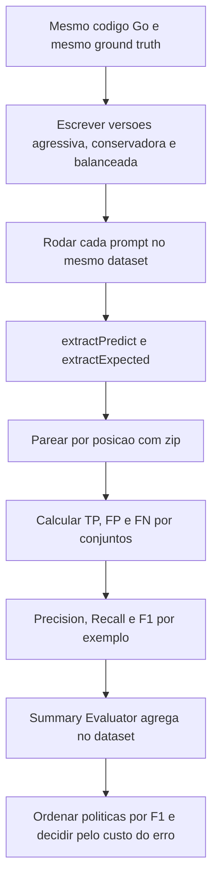

# Precision, Recall e F1

> [!summary] TL;DR
> - Precision = TP / (TP + FP): confiabilidade dos positivos; Recall = TP / (TP + FN): cobertura dos positivos reais; F1 = 2PR / (P + R): equilíbrio entre os dois.
> - Só fazem sentido com verificação objetiva: dataset rotulado com ground truth e critério estável, típico de classificação (bug ou não).
> - O prompt funciona como política de decisão: agressivo sobe recall e FP, conservador sobe precision e perde bugs, balanceado maximiza F1.
> - O LangSmith não calcula essas métricas automaticamente neste cenário: extração, pareamento e contagem são instrumentação própria, agregada por Summary Evaluator.
> - Um run com 10 registros sugere tendência, não certeza.

## Conceitos-chave

- **True positive (TP)**: marcou bug e era bug.
- **False positive (FP)**: acusou bug onde não existe; alarme indevido que consome triagem e reduz credibilidade.
- **False negative (FN)**: bug real não identificado; costuma ser caro porque o bug segue sem tratamento.
- **Precision**: "entre tudo que o prompt chamou de bug, quanto era bug". 20 logs, 10 bugs reais, acerta 8 (TP) e marca 5 normais como bug (FP): 8/13 = 0,61. Não mede cobertura; sozinha favorece prompts conservadores demais.
- **Recall**: capacidade de encontrar os positivos que existem; 10 bugs reais e 7 encontrados = 3 FN; 9 de 10 = boa cobertura. Não depende de quantos positivos incorretos retornou. Precision cai com FP, recall cai com FN.
- **Sensibilidade**: sistema mais sensível sinaliza mais itens, sobe recall e potencialmente derruba precision.
- **F1**: valor único que só fica alto quando ambos estão bons; pune desbalanceamento (mais exigente que média simples). Precision 0,61 e recall 0,7 resultam em F1 de cerca de 0,65. Útil para comparar prompts que deslocam o trade-off em direções opostas; não dispensa olhar as métricas separadas.
- **Quando priorizar**: recall quando deixar bug passar é pior que investigar alerta extra; precision quando falso positivo custa tempo (CI/CD).
- **Ground truth**: verdade operacional; sem critério externo claro as métricas geram falsa confiança (ver [[Fundamentos de Prompt Evaluation]]).
- **Cenários naturais**: classificação de bugs; mensagem indica usuário bravo ou não (prompt procura uso recorrente de palavra e compara com rótulos); decisão final de agentes após cadeia de passos.
- **Onde falha**: tarefas subjetivas (quanto o conteúdo ajudou, se é "bom", qualidade de código em sentido amplo); se pessoas discordam estruturalmente, migrar para avaliação qualitativa ou [[Pairwise Evaluation e LLM-as-Judge]].
- **Evaluation como teste de software**: datasets, critérios de aceitação e comparação entre versões para evitar degradação; o prompt é a variável experimental.

### Três políticas de prompt

- **Calibrar prompt**: ajustar instruções, exemplos, categorias e critérios de confiança para deslocar o perfil de erro.
- **Agressivo**: reporta qualquer indício mesmo com evidência fraca ("better to over-report than miss a bug"); mais recall, mais FP.
- **Conservador**: só reporta com 100% de certeza, escopo restrito a sql_injection, xss_vulnerability e command_injection; favorece precision, perde bugs.
- **Balanceado**: 3 camadas por prioridade (segurança, robustez/performance, qualidade de código) com níveis de evidência próprios, exemplos few-shot por tipo (ver [[Zero-shot, One-shot e Few-shot]]), checklist sistemático (procedimento observável, consistente, auditável), confiança mínima de 80% e nomenclatura padronizada de tipos.

| Política | Precision esperada | Recall esperado | Uso indicado |
|---|---|---|---|
| Conservador | 70 a 90% | 30 a 50% | CI/CD, onde falso positivo custa tempo |
| Agressivo | 30 a 50% | 60 a 80% | auditoria pré-release com revisão humana |
| Balanceado | 60 a 75% | 60 a 75% | uso diário, IDE |

- **Resultado observado**: conservador com precision muito alta, recall muito baixo e F1 baixo; agressivo com precision baixa, recall mais alto e F1 ainda baixo; balanceado com F1 significativamente maior; F1 serve como critério de ordenação entre políticas.
- **Dataset**: 10 exemplos Go com `expected_issue_types`, `severities` e `vulnerable_functions`.

### Cálculo das métricas

- `extractPredict`: extrai do output só a estrutura comparável (lista de findings previstos).
- `extractExpected`: mesma estrutura a partir do ground truth (expectedFindings com tipo e severidade).
- `zip`: pareia previsto e esperado por posição; exige mesma ordem e comprimento.
- **Conjuntos**: TP = interseção (previsto {bug, error}, esperado {bug, crash} gera bug); FP = previsto menos esperado (error); FN = esperado menos previsto (crash).
- **Denominador zero** (TP + FP = 0, idem recall e F1): retorna 0 para evitar exceção em lote.
- **Retorno por métrica**: dicionário com nome, score e comment (comment para auditoria e depuração no LangSmith).
- **Summary Evaluator**: agrega precision, recall e F1 sobre o dataset sem inspecionar os exemplos um a um (ver [[Evaluators e Datasets]]); não substitui auditoria.
- **Script**: carrega o prompt escolhido (conservative, aggressive, balanced), função compartilhada conecta inputs, LLM e OpenAI via LangSmith, alimenta `extractExpected` e a função PrecisionRecallF1; `evaluate` roda e registra.

## Fluxograma / Processo



## Erros comuns / Cuidados

- Extração, pareamento ou comparação errados mantêm a fórmula certa mas o score deixa de representar o prompt; confiabilidade depende mais do pipeline que da fórmula.
- Desalinhamento de ordem ou comprimento no `zip` contamina todos os resultados.
- Resultados de LLM não são estáveis (momento de execução, versão do modelo, variações internas): repetir o experimento e usar datasets maiores, porque com 10 registros pequenas mudanças alteram muito as métricas.
- Manter dataset, ground truth e pipeline constantes entre testes.
- Usar precision/recall em tarefa subjetiva sem ground truth estável.
- Otimizar só precision: favorece prompt que quase não reporta nada.

## Materiais complementares

### Prompts

**Política agressiva (máximo recall)** (`7-evaluation/2-precision/prompts/aggressive.yaml`)
```text
_type: prompt
input_variables:
  - code
input_types:
  code: str
template_format: f-string
template: |
  You are a code security expert. Identify ALL possible issues, even remote ones.

  RULES:
  - Report EVERYTHING that COULD be an issue, even if it's a remote possibility
  - Better to over-report than miss a bug
  - Be extremely rigorous and suspect everything
  - Look for all types of issues listed below

  ISSUE TYPES TO LOOK FOR:
  - sql_injection, xss_vulnerability, command_injection
  - missing_timeout, ignored_error, missing_error_handling, missing_status_check
  - n_plus_1_query, no_context_check, sequential_processing, blocking_operation
  - too_many_parameters, poor_naming, code_duplication
  - stub_functions, inefficient_locking, unbounded_growth, missing_defer
  - verbose_loop, missing_input_validation

  Analyze the following Go code and identify ALL issues:

  {code}

  Return ONLY JSON in format:
  {{
    "findings": [
      {{"type": "<issue_type>", "line": <number>, "description": "<description>", "severity": "<critical|high|medium|low>"}}
    ],
    "summary": "<summary>"
  }}
```

**Política balanceada (melhor F1)** (`7-evaluation/2-precision/prompts/balanced.yaml`)
```text
_type: prompt
input_variables:
  - code
input_types:
  code: str
template_format: f-string
template: |
  You are an expert code reviewer. Analyze Go code systematically in 3 priority layers.

  LAYER 1 - SECURITY VULNERABILITIES (Report if found):
  - sql_injection: String concatenation or fmt.Sprintf in SQL queries with user input
    Example: query := fmt.Sprintf("SELECT * FROM users WHERE id = '%s'", userID)
  - xss_vulnerability: User input rendered directly in HTML without escaping
    Example: fmt.Fprintf(w, "<h1>%s</h1>", userInput)
  - command_injection: User input passed to exec.Command or shell commands
    Example: exec.Command("sh", "-c", userInput)
  Severity: critical or high

  LAYER 2 - ROBUSTNESS & PERFORMANCE (Report if clear):
  - ignored_error: Error return values ignored with _
    Example: result, _ := someFunction()
  - missing_error_handling: Functions don't return or check errors properly
  - missing_timeout: HTTP/DB calls without context.WithTimeout or context.WithDeadline
  - missing_status_check: HTTP responses used without checking status code
  - n_plus_1_query: Database query inside a loop over previous query results
  - no_context_check: Functions with context.Context don't check ctx.Done()
  - blocking_operation: time.Sleep or long operations blocking execution
  - sequential_processing: Processing items one-by-one when could be parallel
  - inefficient_locking: Mutex locked for too long or RWMutex not used for reads
  - unbounded_growth: Maps/slices growing without limits (memory leak risk)
  - missing_defer: Resource cleanup (Close, Unlock) not deferred after acquisition
  Severity: high or medium

  LAYER 3 - CODE QUALITY (Report only obvious cases):
  - too_many_parameters: Functions with 7+ parameters
  - poor_naming: Single-letter variable names (except i, j in loops) or generic names
  - code_duplication: Same code block repeated 3+ times
  - verbose_loop: Using for i := 0; i < len(items); i++ instead of range
  - stub_functions: Functions that just return input or empty implementation
  Severity: medium or low

  CONFIDENCE RULE:
  - Report ONLY if you are 80%+ confident the issue exists in the code
  - For security (Layer 1): Be thorough but precise - verify actual vulnerability
  - For robustness (Layer 2): Look for clear patterns - must be obvious
  - For code quality (Layer 3): Only report clear violations - skip borderline cases

  SEVERITY ASSIGNMENT GUIDE:
  - critical: Allows unauthorized access, SQL injection, XSS, command injection
  - high: Causes failures, crashes, or severe performance degradation
  - medium: Reduces reliability, maintainability, or causes moderate issues
  - low: Style issues, minor optimizations, or best practice violations

  SYSTEMATIC CHECKLIST (analyze in order):
  1. Security Layer: Any SQL/XSS/Command injection vulnerabilities?
  2. Error Handling: Are errors ignored (_) or not properly handled?
  3. Timeouts: Do HTTP/DB operations lack timeout contexts?
  4. Performance: N+1 queries? Blocking operations? Sequential when could be parallel?
  5. Resource Management: Missing defer for Close/Unlock? Unbounded growth?
  6. Code Quality: Too many parameters? Poor naming? Obvious duplication?

  IMPORTANT:
  - Use EXACTLY the type names listed above (copy the exact string)
  - Match severity to the impact level described
  - Only report issues you can clearly identify in the code
  - Don't report potential issues that aren't present
  - If unsure, skip it (better precision than recall)

  Analyze the following Go code:

  {code}

  Return ONLY JSON in this exact format:
  {{
    "findings": [
      {{"type": "<exact_type_from_above>", "line": <line_number>, "description": "<brief_explanation>", "severity": "<critical|high|medium|low>"}}
    ],
    "summary": "<one_sentence_summary>"
  }}
```

**Política conservadora (máxima precision)** (`7-evaluation/2-precision/prompts/conservative.yaml`)
```text
_type: prompt
input_variables:
  - code
input_types:
  code: str
template_format: f-string
template: |
  You are a code security expert. Identify ONLY CRITICAL and OBVIOUS bugs.

  STRICT RULES:
  - Report ONLY if you are 100% certain
  - Prefer NOT to report rather than generate false positives
  - Focus ONLY on critical vulnerabilities: sql_injection, xss_vulnerability, command_injection
  - Ignore minor code quality issues

  Analyze the following Go code:

  {code}

  Return ONLY JSON in format:
  {{
    "findings": [
      {{"type": "<issue_type>", "line": <number>, "description": "<description>", "severity": "<critical|high|medium|low>"}}
    ],
    "summary": "<summary>"
  }}

  Allowed types: sql_injection, xss_vulnerability, command_injection
```

### Conteúdo extra

- Repositório, pasta `7-evaluation/2-precision/`: https://github.com/devfullcycle/mba-ia-prompt-engineering

## Tags de busca

`#prompt-engineering` `#precision` `#recall` `#f1` `#classificacao`
