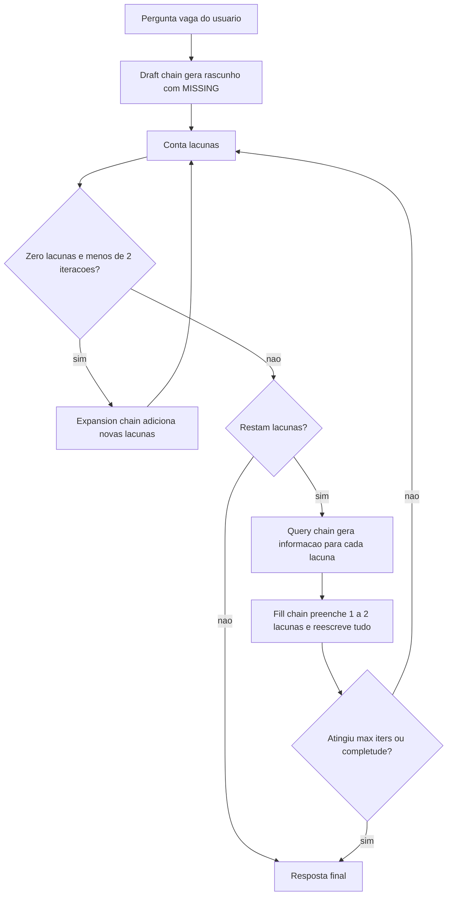

# ITER-RETGEN

> [!summary] TL;DR
> - Iterative Retrieval Generation: loop que alterna geração e recuperação para transformar uma pergunta vaga numa resposta muito mais completa.
> - O rascunho marca lacunas com `[MISSING: ...]`; cada lacuna vira pergunta, é respondida e preenchida aos poucos.
> - Quatro prompts: Draft, Query, Fill e Expansion, cada um com sua chain LangChain.
> - Teste com "Explain about the LangChain and LangGraph": após 3 iterações o documento ficou quase 100% maior que o baseline sem expansão.
> - Custo: muitas chamadas ao modelo, logo mais tokens e mais demora.

## Conceitos-chave

- **ITER-RETGEN**: enriquece a resposta, enquanto query enrichment enriquece a pergunta ([[Query Reformulation e Prompt Enrichment]]).
- **Missing markers**: lacunas explícitas no rascunho, ex: "A última versão da linguagem Python é [MISSING]", "Python foi criado por [MISSING]".
- **Draft**: prompt provocativo que pede uma resposta inicial com detalhes específicos marcados como faltantes (versões, datas, especificações, benchmarks, comparações, implementação, casos reais, limitações, roadmap), no máximo 5 marcadores.
- **Query**: transforma cada `[MISSING: ...]` numa informação a buscar, com dados mais reais possíveis (máximo 5 itens).
- **Fill**: recebe pergunta original, draft atual, informações coletadas e número da iteração; substitui ao menos 1 a 2 marcadores, não cria novos e reescreve a resposta inteira.
- **Expansion**: quando o modelo resolve tudo cedo (zero lacunas nas 2 primeiras iterações), adiciona novos marcadores para detalhes mais profundos e força mais uma rodada.
- **Parâmetros do loop**: `max_iters=10`, `target_completeness=0.95`, para quando chega a 0 lacunas, com controle de iterações sem progresso.
- **Baseline sem expansão**: `init_chat_model("openai:gpt-4o-mini", temperature=0.7)`, chain prompt, LLM e `StrOutputParser`, sem streaming; imprime a resposta e o tamanho dela. Resultado: resumo genérico, sem nuances para busca aprofundada.
- **"Tudo é prompt"**: a técnica é encadeamento de prompts ([[Prompt Chaining]]); o draft com lacunas lembra o raciocínio explícito de [[Chain of Thought e Self-Consistency]], e o ciclo gerar/buscar lembra [[ReAct]].
- **Limite do conhecimento do modelo**: no teste, o modelo informou versão desatualizada do LangChain (0.12) por causa da data de treino; sem recuperação externa real, as lacunas são preenchidas com o conhecimento paramétrico.

## Fluxograma / Processo



## Erros comuns / Cuidados

- Várias chamadas ao modelo por pergunta: avaliar custo e latência antes de usar em produção ([[Custo, Latência e Escala de Prompts]]).
- O modelo tende a manter o marcador em vez de substituí-lo; o fill prompt traz exemplo WRONG/RIGHT para corrigir isso.
- Sem limite, o draft gera marcadores demais; o prompt fixa no máximo 5.
- Dados preenchidos sem fonte externa podem estar desatualizados ou inventados ([[Alucinação em LLMs]]).
- O código da aula é verboso só para tracking e debug; poderia ser 5x menor.

## Materiais complementares

### Prompts

**Baseline sem expansão (`0-No-expansion.py`)**
```text
from dotenv import load_dotenv
from langchain.chat_models import init_chat_model
from langchain_core.prompts import PromptTemplate
from langchain_core.output_parsers import StrOutputParser

load_dotenv()

llm = init_chat_model("openai:gpt-4o-mini", temperature=0.7)

prompt = PromptTemplate(
    input_variables=["question"],
    template=(
        "You are a technology assistant.\n"
        "Answer the following question:\n\n"
        "{question}"
    ),
)

chain = prompt | llm | StrOutputParser()

question = (
        "Explain about the LangChain and LangGraph"
    )

    # Get answer
answer = chain.invoke({"question": question})

print(answer)
print(len(answer))
```

**Draft: rascunho inicial com lacunas (`1-ITER_RETGEN.py`)**
```text
# Prompt to generate initial draft with MANY specific gaps
draft_prompt = PromptTemplate(
    input_variables=["question"],
    template=(
        "You are an expert assistant with limited initial knowledge.\n"
        "Answer the following question, but you MUST mark MANY specific details as missing.\n"
        "Use [MISSING: ...] markers for:\n"
        "- Specific version numbers and release dates\n"
        "- Technical specifications and parameters\n"
        "- Performance metrics and benchmarks\n"
        "- Comparison data between different versions\n"
        "- Implementation details and code examples\n"
        "- Real-world use cases and case studies\n"
        "- Limitations and known issues\n"
        "- Future roadmap and upcoming features\n\n"
        "Be thorough in identifying what specific information would make the answer complete.\n"
        "Start with a basic overview but mark MANY specific details as missing.\n\n"
        "Do not generate more than 5 MISSING Markers."
        "Question: {question}\n\n"
        "Answer:"
    ),
)
```

**Query: gerar informação para cada lacuna (`1-ITER_RETGEN.py`)**
```text
# Prompt to generate queries from gaps - now more specific
query_prompt = PromptTemplate(
    input_variables=["draft"],
    template=(
        "You received the following draft with gaps:\n{draft}\n\n"
        "For each [MISSING: ...] marker, provide information to fill that gap.\n"
        "Format each as: 'For [MISSING: topic]: provide the actual information'\n"
        "Be specific and provide real data when possible.\n"
        "Example: 'For [MISSING: version numbers]: LangChain is at version 0.1.0, LangGraph at 0.2.0'\n"
        "List information for each gap, maximum 5 items."
    ),
)
```

**Fill: preencher lacunas gradualmente (`1-ITER_RETGEN.py`)**
```text
# Prompt to fill gaps gradually based on complexity
fill_prompt = PromptTemplate(
    input_variables=["question", "draft", "queries", "iteration"],
    template=(
        "Original question: {question}\n\n"
        "Current draft (iteration {iteration}):\n{draft}\n\n"
        "Information to help fill the gaps:\n{queries}\n\n"
        "CRITICAL INSTRUCTIONS:\n"
        "1. You MUST replace AT LEAST 1-2 [MISSING: ...] markers with concrete information\n"
        "2. ACTUALLY REPLACE the text '[MISSING: xyz]' with real content - don't keep the marker\n"
        "3. Use the information above to guide what content to add\n"
        "4. Do NOT add any new [MISSING:] markers - only fill or keep existing ones\n"
        "5. If you cannot fill a gap with certainty, keep it as [MISSING: ...]\n\n"
        "Example of what to do:\n"
        "- WRONG: '[MISSING: version numbers and release dates]' (keeping the marker)\n"
        "- RIGHT: 'LangChain version 0.1.0 was released in January 2024' (replacing with content)\n\n"
        "Important: This is iteration {iteration}. You MUST make progress by filling gaps.\n\n"
        "Rewrite the ENTIRE answer with the [MISSING:] markers replaced:"
    ),
)
```

**Expansion: adicionar novas lacunas para aprofundar (`1-ITER_RETGEN.py`)**
```text
# New prompt to identify additional gaps after filling
expansion_prompt = PromptTemplate(
    input_variables=["draft"],
    template=(
        "Review this draft answer:\n{draft}\n\n"
        "Identify areas that could benefit from MORE specific information.\n"
        "Add new [MISSING: ...] markers for:\n"
        "- Technical details that were glossed over\n"
        "- Specific examples that would clarify concepts\n"
        "- Comparative data that would add context\n"
        "- Implementation specifics that developers would need\n\n"
        "Return the same text but with ADDITIONAL [MISSING: ...] markers for deeper details:"
    ),
)
```

### Conteúdo extra

- Repositório: https://github.com/devfullcycle/mba-ia-prompt-engineering (pasta `6-prompt-enriquecido/`, arquivos `0-No-expansion.py` e `1-ITER_RETGEN.py`).
- Chains criadas a partir dos templates:

```python
draft_chain = draft_prompt | llm | StrOutputParser()
query_chain = query_prompt | llm | StrOutputParser()
fill_chain = fill_prompt | llm | StrOutputParser()
expansion_chain = expansion_prompt | llm | StrOutputParser()
```

## Tags de busca

`#prompt-engineering` `#iter-retgen` `#prompt-enrichment` `#missing-markers` `#langchain`
