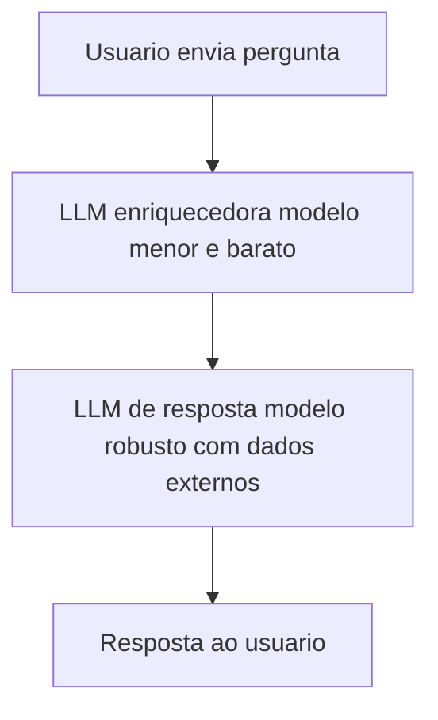
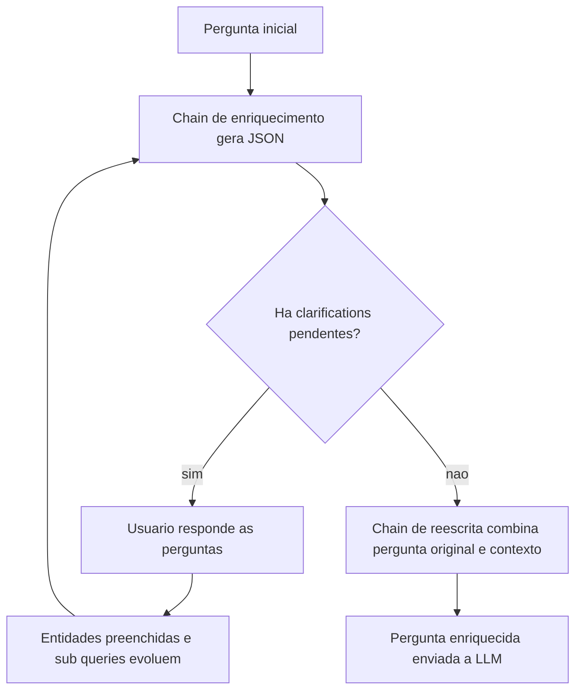

# Query Reformulation e Prompt Enrichment

> [!summary] TL;DR
> - Técnicas subestimadas para tratar perguntas mal formuladas ou incompletas: reformular a query (principalmente para busca em fontes externas) e enriquecer o prompt antes da resposta.
> - Pergunta ruim gera resposta incompleta, mais iterações do usuário, mais tokens gastos e insatisfação; o usuário culpa o sistema.
> - Fluxo básico: usuário, LLM enriquecedora (modelo menor, barato e rápido), LLM de resposta (modelo robusto com acesso a dados externos).
> - Cada chamada extra ao modelo soma latência e custo: enriquecimento com LLM leva 3 a 5 s contra 10 a 150 ms de uma API tradicional.
> - Query enrichment estruturado: o sistema pergunta ao usuário em loop até obter todas as informações obrigatórias e então reescreve uma pergunta final enriquecida.

## Conceitos-chave

- **Query reformulation**: reescrever a pergunta do usuário para melhorar a recuperação em fontes externas ou a resposta do modelo; técnicas específicas para busca são [[Query2Doc e HyDE]].
- **Prompt enrichment**: acrescentar ao prompt contexto, formato e restrições que o usuário não informou.
- **Consulta vaga ou ambígua**: inferir a intenção. "Python e LangChain" vira "crie um guia completo explicando como trabalhar com LangChain utilizando Python, do básico ao avançado".
- **Falta de contexto relevante** (o clássico "depende", ex: Go ou Python?): "como criar uma API em Python?" vira "explique como desenvolver um CRUD em Golang e disponibilizar endpoints REST utilizando o framework Gin" (adiciona CRUD, protocolo REST e framework).
- **Alinhar formato da resposta**: "explique as regras de negócio desse sistema" vira "faça um resumo das regras de negócio, módulo a módulo, e retorne em Markdown no formato: regras de negócio, regra X, conteúdo do resumo". JSON costuma ser essencial para integração com sistemas que não entendem Markdown.
- **Minimizar respostas incorretas**: premissa falsa induz [[Alucinação em LLMs]]. "quem criou a linguagem Python em 2012?" vira "quem foi o criador da linguagem Python e em que ano ela foi lançada?".
- **Busca semântica e recuperação**: corrigir ortografia, expandir sinônimos, incluir termos em inglês e português. "esse código está serto em Go" vira "revise o seguinte código na linguagem Go, identifique possíveis bugs, problemas de performance, segurança ou violações, e forneça sugestões de melhoria com exemplos".
- **Personalização**: usar perfil, público, contexto do usuário e memória de longo prazo (como no ChatGPT). "explique como desenvolver aplicações com IA e Python" vira "explique como desenvolver aplicações com Python para quem nunca teve contato com a linguagem e, a cada exemplo, mostre um comparativo com TypeScript".
- **Alternativa sem LLM**: reformulação por palavras-chave mais cache de perguntas frequentes que concatena contexto pré-pronto; menos refinada, mas economiza custo e latência.
- **Regra de desenho**: a primeira coisa a pensar é quantas chamadas ao modelo serão feitas; quanto menos camadas, melhor. Números do material: API tradicional 10 a 150 ms, enriquecimento com LLM 3 a 5 s, resposta final até 60 s. O enriquecimento compensa porque evita o retry do usuário (retry = mais tokens); ver [[Custo, Latência e Escala de Prompts]].
- **Usuário**: pode ser uma pessoa, outra IA ou uma integração.
- **Interceptações**: enriquecimento é uma das camadas possíveis no fluxo; outras são segurança, antes/depois de executar ferramenta e antes/depois de chamar o modelo.
- **Enriquecer a pergunta vs enriquecer a resposta**: query enrichment melhora a própria pergunta; [[ITER-RETGEN]] gera uma resposta mais completa a partir de pergunta vaga.
- **Caso de revisão de pull request**: 6 informações obrigatórias (PR ID, repositório, branch, concerns, style guide, test requirements); se faltar dado, o sistema pergunta ao usuário em loop e depois gera a pergunta final para banco, LLM ou ferramenta.
- **Saída estruturada**: tendência de estruturar respostas de LLM em modelos de dados (Pydantic, Data Classes) em vez de só linguagem natural. Modelo `EnrichedQuery`: `is_complex` (pergunta complexa?), `sub_queries` (tarefas menores), `clarifications` (perguntas ainda necessárias), `entities` (dados capturados, ex: "minha PR é a PR ID 10" vira PR ID 10).
- **Fontes alternativas de enriquecimento**: contexto anterior (última PR, branch, projeto), perfil do usuário, último código mexido, função do usuário, guias da empresa, banco de dados, tool calls.
- **Implementação**: duas chains LangChain encadeadas ([[Prompt Chaining]]): enriquecimento com `JsonOutputParser(pydantic_object=EnrichedQuery)` e reescrita com `StrOutputParser`; `openai:gpt-4o-mini`, `temperature=0.0`, `max_rounds=10`; usa mensagens system/user ([[System, User e Assistant Prompts]]).

## Fluxograma / Processo

Fluxo básico de enriquecimento:



Query enrichment interativo:



Exemplo de execução: entrada "revise a minha pull request"; após os rounds (PR 1, repo iagem, branch test, concerns "golang style to be used", testes "atingir 80% de cobertura") a saída foi "Você poderia revisar minha pull request com ID 1 no repositório iagem, no branch test, garantindo que siga o style guide Go e atinja os requirements de 80% de cobertura de testes." Se a pergunta inicial já traz repo e branch, o sistema captura essas entidades e só pergunta o resto.

## Erros comuns / Cuidados

- Empilhar camadas de LLM sem medir: cada chamada adiciona latência e custo.
- O modelo tende a esvaziar `clarifications` cedo; o prompt reforça em caixa alta que só pode ficar vazio quando as 6 informações estiverem presentes.
- Ajustes no prompt de enriquecimento melhoram a captura de entidades já presentes na pergunta inicial.

## Materiais complementares

### Prompts

**Prompt de enriquecimento (system + user, `2-query-enrichment.py`)**
```text
enrichment_prompt = ChatPromptTemplate.from_messages([
    ("system", f"""You are a query refinement assistant for software development questions.

Your task is to identify missing information and generate clarifying questions.

CRITICAL: You MUST ask for ALL 6 required pieces of information. Do NOT stop early.

Required information (ALL must be explicitly provided):
1. PR ID
2. Repository name
3. Branch name
4. Specific concerns
5. Style guide
6. Test requirements

Output STRICT JSON with this structure:
{{{{
  "is_complex": bool,
  "sub_queries": [string],
  "clarifications": [string],
  "entities": [string]
}}}}

Rules:
- clarifications: MUST include questions for ANY of these that are NOT explicitly mentioned in the query:
{questions_text}
  IMPORTANT: Keep the clarifications list populated until ALL 6 items above are provided.
  Even if you have PR ID, repository, and branch, you MUST still ask for concerns, style guide, and test requirements.
- sub_queries: Break down the request into specific tasks
- entities: Extract ONLY the information that was actually provided
- is_complex: true if multiple sub-tasks are needed

NEVER set clarifications to empty [] unless ALL 6 required items are explicitly present in the query."""),
    ("user", "{question}")
])
```

**Prompt de reescrita em linguagem natural (`2-query-enrichment.py`)**
```text
rewrite_prompt = ChatPromptTemplate.from_messages([
    ("system", "Rewrite the information into a single, natural, well-formed question. Be concise and clear."),
    ("user", "Original request: {original}\n\nAdditional context:\n{context}")
])
```

### Conteúdo extra

- Repositório: https://github.com/devfullcycle/mba-ia-prompt-engineering (pasta `6-prompt-enriquecido/`, arquivo `2-query-enrichment.py`; executar `python query_enrichment.py`).
- Configuração das 6 informações e modelo de saída:

```python
@dataclass
class EnrichmentConfig:
    """Configuration for query enrichment"""
    model_name: str = "openai:gpt-4o-mini"
    temperature: float = 0.0
    max_rounds: int = 10

    # Define what information we want to collect
    required_information: List[Dict[str, str]] = None

    def __post_init__(self):
        if self.required_information is None:
            # Default configuration for PR review scenario
            self.required_information = [
                {"field": "pr_id", "question": "What is the PR ID?"},
                {"field": "repository", "question": "What is the repository name?"},
                {"field": "branch", "question": "What is the branch name?"},
                {"field": "concerns", "question": "What are your specific concerns?"},
                {"field": "style_guide", "question": "What style guide should be followed?"},
                {"field": "test_requirements", "question": "What are the test requirements?"},
            ]


class EnrichedQuery(BaseModel):
    """Structure for enriched query output"""
    is_complex: bool = Field(description="Whether the query is complex")
    sub_queries: List[str] = Field(description="Breakdown into specific tasks")
    clarifications: List[str] = Field(description="Questions needing clarification")
    entities: List[str] = Field(description="Extracted entities")
```

## Tags de busca

`#prompt-engineering` `#query-reformulation` `#prompt-enrichment` `#saida-estruturada` `#pydantic`
