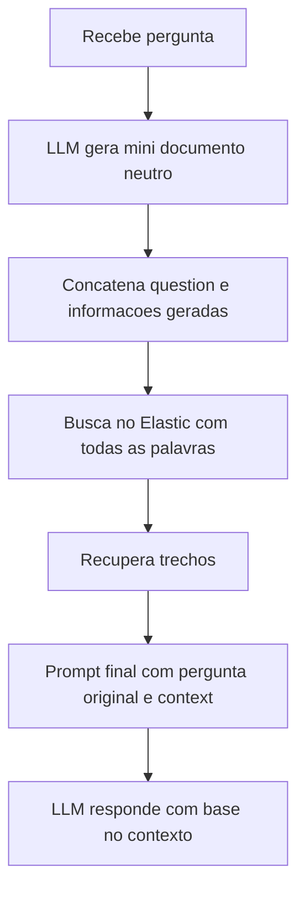
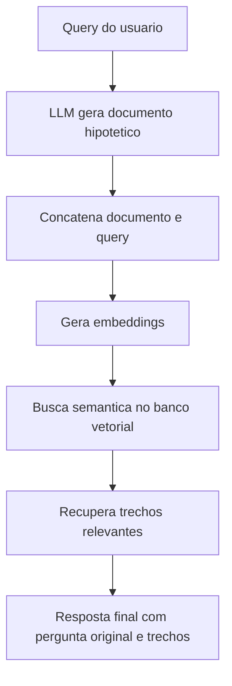

# Query2Doc e HyDE

> [!summary] TL;DR
> - As duas técnicas usam um LLM para gerar texto que expande a query antes da busca; o texto gerado nunca é a resposta final.
> - Query2Doc gera um mini-artigo neutro e explicativo, focado em vocabulário (sinônimos, termos alternativos), para busca léxica (BM25, Elastic, Apache Lucene).
> - HyDE gera um documento hipotético que parece a resposta final, transforma em embeddings e faz busca semântica em banco vetorial (Pinecone, PostgreSQL com pgVector).
> - A diferença principal entre elas é o estilo de texto pedido ao LLM.
> - A resposta final sempre usa pergunta original mais trechos recuperados da fonte da verdade.

## Conceitos-chave

- **Query2Doc (Query-to-Doc)**: LLM gera um mini-documento neutro que explica a consulta, expandindo a query com termos para o ranqueamento léxico; é uma forma de [[Query Reformulation e Prompt Enrichment]] voltada à busca.
- **Busca léxica**: ranqueamento por palavras-chave e termos frequentes (BM25, Elastic, Apache Lucene); Query2Doc não é busca vetorial.
- **Neutralidade**: o texto do Query2Doc não responde a pergunta; só traz definições, termos técnicos, sinônimos e contexto.
- **Few-shot no Query2Doc**: o prompt pode trazer exemplos de pergunta e mini-documento correspondente ([[Zero-shot, One-shot e Few-shot]]).
- **Relação com RAG**: parecido com RAG, mas aqui a função do LLM é gerar conteúdo para melhorar a busca; ver [[Prompt Engineering vs RAG vs Fine-Tuning]].
- **HyDE (Hypothetical Document Embedding)**: gera um documento com cara de resposta real, que pode conter dados incorretos, para gerar embeddings e buscar por similaridade semântica.
- **Documento hipotético temporário**: o documento "fake" só serve para recuperar chunks do banco; nunca entra na resposta final, o que evita propagar [[Alucinação em LLMs]].
- **Origem do HyDE**: surgiu para melhorar Dense Retrieval em cenários zero-shot, quando o usuário não fornece exemplos.
- **Exemplo**: "o que é Go?" tem pouco contexto; o documento hipotético cita documentação, versão, APIs e biblioteca padrão, aproximando a query dos documentos reais.

| | Query2Doc | HyDE |
|---|---|---|
| Texto gerado | mini-artigo explicativo e neutro | resposta hipotética realista |
| Foco | vocabulário: sinônimos, termos alternativos | semântica, contexto e nuances |
| Busca | léxica, BM25/Elastic | vetorial, embeddings |
| Quando usar | quem já usa Elastic; técnica mais antiga | quem usa banco vetorial |

## Fluxograma / Processo

Query2Doc:



HyDE:



## Erros comuns / Cuidados

- Usar o mini-documento ou o documento hipotético como resposta: os dois servem só para recuperação.
- No HyDE, linguagem especulativa ("talvez", "possivelmente") afasta o texto do estilo de documento real e piora a similaridade.
- No Query2Doc, deixar o LLM responder diretamente reduz o ganho de vocabulário para o BM25.

## Materiais complementares

### Prompts

**Query2Doc: gerar mini-documento neutro para busca léxica (narrado na aula)**
```text
Escreva um texto informativo e neutro, de 100 a 150 palavras, que explique o tópico abaixo. Inclua definições, termos técnicos, sinônimos e contexto relacionado, mas não forneça uma resposta direta caso seja uma pergunta.
```

**HyDE: gerar documento hipotético para embeddings (narrado na aula)**
```text
Escreva um parágrafo conciso que responda de forma clara à pergunta abaixo. A resposta deve parecer um documento real, contendo datas, fatos ou descrições plausíveis, mesmo que hipotéticas. Não utilize linguagem especulativa e não use expressões como talvez ou possivelmente.
```

## Tags de busca

`#prompt-engineering` `#query-reformulation` `#query2doc` `#hyde` `#retrieval`
