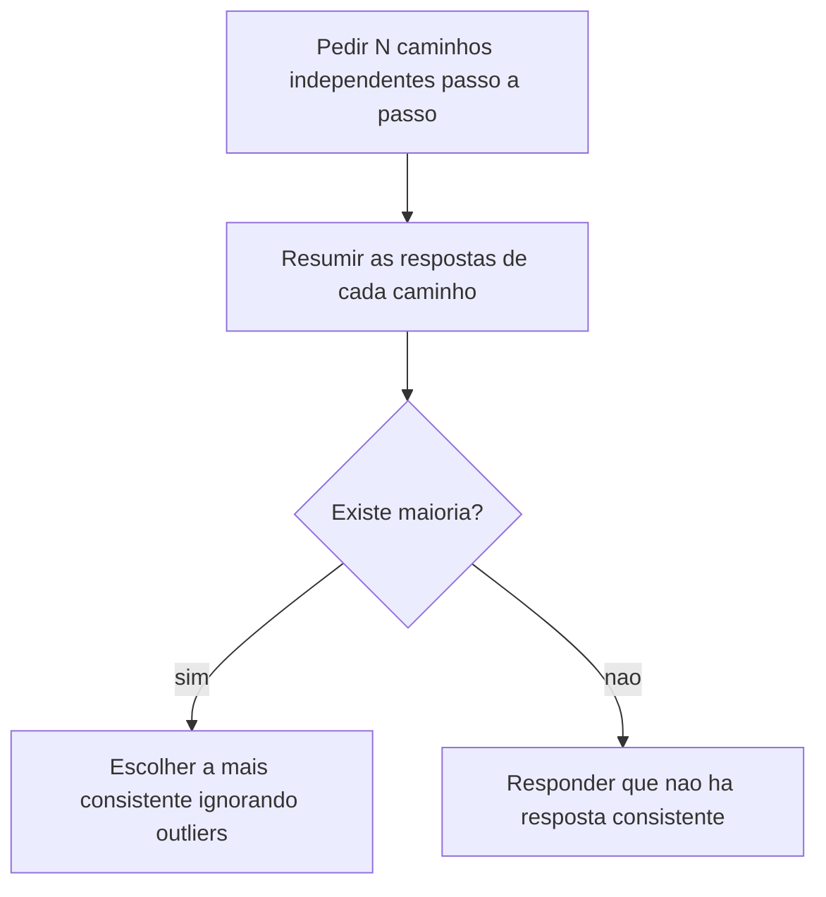

# Chain of Thought e Self-Consistency

> [!summary] TL;DR
> - CoT instrui o modelo a raciocinar em etapas antes da resposta final; o maior valor é auditabilidade ("não basta dizer 22, mostrar como chegou em 22").
> - CoT aumenta tokens, custo e latência; em modelos reasoning pode ser redundante e escalar para centenas ou milhares de tokens numa resposta trivial.
> - Uso estratégico: ativar CoT temporariamente para depurar prompt que erra, depois reavaliar se fica em produção.
> - Self-consistency gera vários caminhos CoT e escolhe a resposta mais consistente, ignorando outliers; consistência é sinal de estabilidade, não prova de verdade.
> - Se o erro do modelo é consistente, a votação consolida o erro.

## Conceitos-chave

- **Chain of Thought (CoT)**: pedir raciocínio passo a passo antes da conclusão; útil quando o caminho importa (cálculos, lógica de algoritmo, análise de bug, decomposição de plano, justificar conclusão em debate técnico). Guia do repositório: raciocínio multi-etapas (matemática, lógica, análise).
- **Roteamento para reasoning**: modelos recentes decidem internamente entre resposta direta e reasoning profundo; "pense passo a passo" pode induzir o caminho mais caro (ver [[Custo, Latência e Escala de Prompts]]).
- **Inconsistência raciocínio x resposta**: o raciocínio exibido pode não bater com a conclusão (explica 1+1=2 e conclui 3).
- **Raciocinar não é exibir raciocínio**: modelo reasoning pode ignorar o passo a passo pedido e responder só "warning".
- **CoT como encadeamento de verificação**: implementar, revisar, comparar com o existente e só então manter; ex: "após criar qualquer função, revise se ela realmente é necessária" (instrução da [[Estrutura de Prompts]]).
- **Teste controlado**: mesma tarefa, mudar só a instrução de raciocínio.
  - Log "Disk usage at 85%": versão direta (só INFO/WARNING/ERROR) vs versão com justificativa e "Answer:"; a versão CoT consumiu bem mais tokens.
  - "strawberry": sem CoT um modelo respondeu 2 r; com decomposição letra a letra em bullets respondeu 3; acerto numa execução não garante estabilidade entre execuções.
  - GPT-5 nano (reasoning nativo) acertou strawberry sem CoT, mas gastou muitos tokens.
  - Modelos diferentes classificaram 85% como INFO ou WARNING (heurísticas distintas).
  - GPT-4o como meio-termo: acertou strawberry, justificou WARNING (gerenciar storage antes do estado crítico), custo menor que reasoning.
- **Self-consistency**: gerar N caminhos independentes de raciocínio e escolher a resposta mais recorrente (maioria/agrupamento, votação entre hipóteses). Guia do repositório: decisões críticas.
- **Outlier**: caminho cuja conclusão foge do padrão dominante, descartado; se todas divergirem, assumir incerteza.
- **Usos de self-consistency**: decisões técnicas, cálculos, interpretação de texto, múltipla escolha.
- **Experimento N+1**: endpoint que busca usuários e depois posts em loop (resposta correta N+1).
  - GPT-3.5 Turbo: caminhos esqueceram a query inicial ou imaginaram otimização inexistente, e a maioria consolidou N (errado).
  - GPT-4o: convergiu repetidamente para N+1.
- **Diferença para ToT**: self-consistency repete a tarefa e consolida a mais recorrente; [[Tree of Thought e Skeleton of Thought]] explora alternativas em branches e escolhe por critério declarado.

## Fluxograma / Processo



## Erros comuns / Cuidados

- CoT melhora inspeção, não substitui validação; usar por padrão é caro e frequentemente desnecessário, e em tarefas simples não compensa.
- CoT explícito em modelo reasoning pode ser redundante ou contraproducente.
- Trocar de modelo sem revalidar o prompt pode mudar o próprio critério de decisão (INFO vs WARNING).
- Validar por repetição em aplicações críticas.
- Self-consistency resolve a tarefa várias vezes: mais tokens e latência; não usar como padrão em toda requisição.

## Materiais complementares

### Prompts

**Sem CoT: classificação direta (3-CoT.py, gpt-3.5-turbo)**
```text
Classify the log severity.

Input: "Disk usage at 85%."
Answer only with INFO, WARNING, or ERROR.
```

**Com CoT: justificativa e resposta após "Answer:" (3-CoT.py)**
```text
Classify the log severity.

Input: "Disk usage at 85%."
Think step by step about why this is INFO, WARNING, or ERROR. 
At the end, give only the final answer after "Answer:".
```

**Sem CoT: contagem de letras (3-CoT.py)**
```text
Question: How many "r" are in the word "strawberry"?
Answer only with the number of "r".
```

**Com CoT: decomposição letra a letra (3-CoT.py)**
```text
Question: How many "r" are in the word "strawberry"?
Explain step by step by breaking down each letter in bullet points, pointing out the "r" before giving the final answer. 
Give the final result after "Answer:".
```

**Self-consistency: problema N+1 em Go com 3 caminhos e voto (3.1-CoT-Self-consistency.py, gpt-4o)**
```text
Question: In an API endpoint that returns a list of users and their posts, the developer wrote:

users := db.FindAllUsers()
for _, u := range users {
    u.Posts = db.FindPostsByUserID(u.ID)
}

How many database queries will this code execute if there are N users?

Generate 3 different reasoning paths step by step.
At the end, summarize the answers and choose the most consistent one, ignoring outliers.
If there are 3 different answers, ONLY reply: "I can't find a consistent answer".
```

### Conteúdo extra

- Repositório: https://github.com/devfullcycle/mba-ia-prompt-engineering (pasta `1-tipos-de-prompts/`, scripts `3-CoT.py` e `3.1-CoT-Self-consistency.py`).

## Tags de busca

`#prompt-engineering` `#chain-of-thought` `#self-consistency` `#modelos-reasoning` `#auditabilidade`
