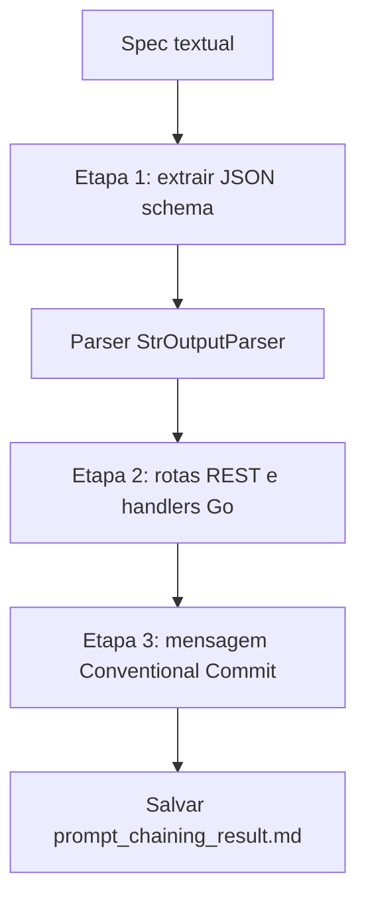

# Prompt Chaining

> [!summary] TL;DR
> - Prompt chaining quebra uma tarefa grande em etapas especializadas: a saída de uma é a entrada da próxima.
> - Ganho: controle da orquestração e escolha de modelo por etapa (mais simples para extração mecânica, mais forte para código).
> - No LangChain cada etapa é um pipe prompt template, LLM e parser, com contrato de entrada e saída.
> - Parsing é dependência crítica: texto fora do JSON quebra a etapa seguinte; erro inicial se propaga de forma coerente e difícil de perceber.
> - Cada etapa soma latência e tokens.

## Conceitos-chave

- **Prompt chaining**: pipeline de prompts encadeados; guia do repositório: workflows multi-estágio.
- **Contrato entre etapas**: quando a saída é consumida por outro modelo, parser, agente ou sistema, o formato vira contrato (ver [[Estrutura de Prompts]]).
- **Pipeline do exemplo**:
  - Etapa 1 (gpt-3.5-turbo): spec textual para JSON schema mínimo; "Only return JSON" reduz ruído.
  - Etapa 2 (gpt-5-mini): schema para rotas REST e handlers CRUD idiomáticos em Go, em Markdown com code blocks.
  - Etapa 3 (gpt-4o-mini): síntese numa mensagem Conventional Commits de uma linha (chaining também condensa).
- **Modelos diferentes por etapa**: decisão arquitetural de custo, latência e capacidade (ver [[Custo, Latência e Escala de Prompts]]); todos com `temperature=0`.
- **Persistência do resultado**: gravar `result_content` em `prompt_chaining_result.md` torna o resultado consultável e versionável.
- **Chaining e agentes**: delegação entre agentes implementa o mesmo princípio (ver [[Workflow e Role Specification]]); [[ITER-RETGEN]] também encadeia geração e recuperação em etapas.

## Fluxograma / Processo



## Erros comuns / Cuidados

- Erro no schema inicial se propaga e gera código e commit coerentes com um estado incorreto.
- Texto extra fora do JSON quebra a etapa seguinte; usar restrições explícitas de formato e parsers.
- Latência e tokens acumulam a cada etapa.

## Materiais complementares

### Prompts

**Passo 1: extrair JSON schema da spec (7-Prompt-channing.py, gpt-3.5-turbo)**
```text
You are a senior backend engineer.
From the following product spec, extract a minimal JSON schema with fields and types.
Only return JSON. No commentary.

Write all the code using markdown code blocks.  

Spec:
{spec}
```

**Passo 2: rotas REST e handlers Go a partir do schema (7-Prompt-channing.py, gpt-5-mini)**
```text
You are a senior Go developer.
Given the JSON schema below, design REST routes and sketch idiomatic Go handlers for CRUD.
Keep it concise, production-oriented, and show code snippets.

Write all the code using markdown code blocks.  

Schema JSON:
{schema_json}
```

**Passo 3: commit convencional resumindo a API (7-Prompt-channing.py, gpt-4o-mini)**
```text
You are a pragmatic developer.
Write a single-line conventional commit message summarizing the new API based on the schema and routes.

Schema:
{schema_json}

Routes and handlers:
{routes}
```

**Entrada spec usada no pipeline (7-Prompt-channing.py)**
```text
We need a Products API.
Fields: id (uuid), name (string, required), description (string), price (float, > 0), stock (int, >= 0).
We must support list with pagination, create, get by id, update, delete.
```

### Conteúdo extra

- Código: `PromptTemplate.from_template(...) | ChatOpenAI(model=..., temperature=0) | StrOutputParser()`, executado com `.invoke({"spec": spec_text})`.
- Repositório: https://github.com/devfullcycle/mba-ia-prompt-engineering (pasta `1-tipos-de-prompts/`, script `7-Prompt-channing.py`; capítulo 1 usa LangChain 0.3.27 e langchain-openai 0.3.32).

## Tags de busca

`#prompt-engineering` `#prompt-chaining` `#langchain` `#lcel` `#output-parser`
