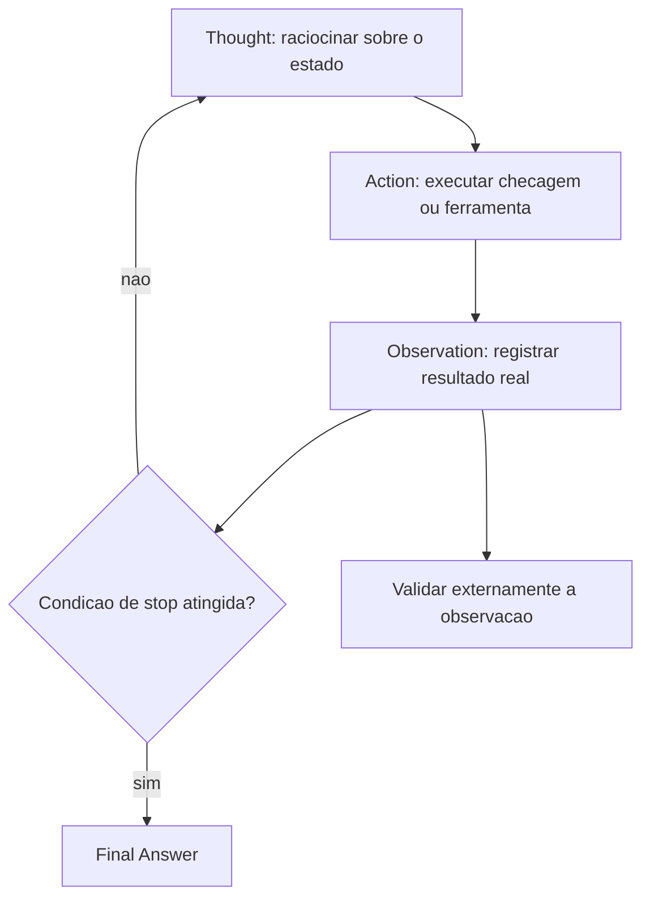

# ReAct

> [!summary] TL;DR
> - ReAct (Reasoning + Acting) alterna Thought, Action e Observation; a observação vira entrada do próximo raciocínio (iterativo, não linear como CoT).
> - É a base de agentes: o modelo vira controlador que decide quando consultar, buscar, executar ou parar; o maior ganho aparece com ferramentas.
> - Ponto de stop é obrigatório: condição de sucesso, limite de iterações, regra de confiança ou orçamento de tokens.
> - Risco principal: afirmar ação não executada ou inventar observação; validar externamente chamadas e respostas e proibir fabricar informação fora do contexto.
> - Verboso, caro e lento em escala; vale em exploração, depuração e fluxos de alto valor, quando o erro custa mais que os tokens.

## Conceitos-chave

- **Loop Thought/Action/Observation**: pensar, executar uma ação (checagem, busca, chamada de ferramenta), registrar o que encontrou e repetir até "Final Answer".
- **ReAct e agentes**: LangChain formaliza o tipo de agente ReAct; o padrão é a base dos [[Prompts de Agentes Especialistas]]; ganho maior com ferramentas (ex: integração GitHub para buscar repositórios). Guia do repositório: agentes com tools (APIs, buscas, ações).
- **Casos de uso**: depuração, busca de informação interna, automação com decisão intermediária, troubleshooting, integração com ferramentas externas, decisão com restrições.
- **Restrição anti-alucinação**: "Do not fabricate any information that is not provided in the context" impede inventar logs, traces ou mensagens de erro plausíveis (ver [[Alucinação em LLMs]]).
- **Prompt de depuração operacional**: papel (backend Go, ver [[Role Prompting]]) + alvo (handler POST /products) + sintoma (sempre HTTP 500) + código + saída em etapas até recomendação final.
- **Raciocínio do exemplo de bug**:
  - Ler o handler como sequência de pontos de falha: decode do body, Prepare, Exec, resposta 201.
  - Eliminar hipóteses pelo status code: JSON inválido gera 400, não 500, então o foco vai para persistência.
  - Bug: `Price string` na struct Product enquanto o banco espera numérico; correção: `Price float64` (ou tipo monetário mais preciso como decimal).
  - Código compila e o fluxo parece correto, mas a persistência quebra por mismatch de tipos entre camadas; o código ainda tem `log.Fatal(err)` no Prepare.
- **Trilha auditável**: o valor do ReAct é mostrar por que hipóteses foram descartadas; dá mais controle que o uso genérico da IDE e vira padrão reutilizável para bugs semelhantes.
- **ReAct para trade-offs**: sequência auditável de verificações (custo, duração, conveniência, descanso); estrutura = papel (planejador de viagens) + contexto + opções com custos + critério de saída.
- **Números do exemplo de viagem** (família 2 adultos e 2 crianças de 5 e 8 anos, teto US$ 1.000, chegar na noite de 10/jul, aula termina 9/jul ao meio-dia, casamento na manhã de 11/jul):
  - Voo: US$ 220 x 4 = 880 + 80 de bagagem = 960, dentro do teto, 5 a 6 h com aeroporto.
  - Trem: 150 x 4 = 600, com camas 800, cabe no orçamento mas leva 20 h.
  - Carro: US$ 60/dia + gasolina e pedágio ~250, abaixo do teto mas 2 dias dirigindo cada trecho.
  - Recomendação: voo, melhor equilíbrio custo x conveniência, não o menor preço.
- **Restrições humanas explícitas**: cansaço das crianças, chegar descansado ao casamento; se não entram como critérios explícitos, o modelo as ignora.

## Fluxograma / Processo



## Erros comuns / Cuidados

- Modelo pode afirmar uma ação que não executou ou inventar observação, e o raciocínio seguinte se apoia em estado falso.
- Produção exige controlar ferramentas, estado, parada, orçamento e validação.
- Respostas longas e mais tokens; em troca, decisão auditável (conferir cálculos, restrições e coerência da recomendação com as observações).
- Sem stop definido, o loop fica sem segurança operacional.

## Materiais complementares

### Prompts

**ReAct: debug de handler Go que sempre retorna 500 (6-ReAct.py msg1, gpt-4o)**
````text
You are a Go backend engineer helping debug a REST API. 
Use the ReAct style reasoning: alternate between "Thought:" (your reasoning) and "Action:" (a concrete step or check you would perform). 
After each action, write "Observation:" to capture what you found. 
At the end, conclude with "Final Answer:" as your recommended fix.

Do not fabricate any information that is not provided in the context. Example: if the context does not provide errors logs, do not use error logs in your reasoning.

Context: A user reports that the endpoint `POST /products` always returns HTTP 500.  

Here is the handler code for `POST /products`:

```go
func CreateProduct(w http.ResponseWriter, r *http.Request) {
    var product Product
    err := json.NewDecoder(r.Body).Decode(&product)
    if err != nil {
        http.Error(w, "Bad Request", http.StatusBadRequest)
        return
    }

    stmt, err := db.Prepare("INSERT INTO products (id, name, description, price, stock) VALUES (?, ?, ?, ?, ?)")
    if err != nil {
        log.Fatal(err)
    }

    _, err = stmt.Exec(product.ID, product.Name, product.Description, product.Price, product.Stock)
    if err != nil {
        log.Println("Error during Exec:", err)
        http.Error(w, "Internal Server Error", http.StatusInternalServerError)
        return
    }

    w.WriteHeader(http.StatusCreated)
}

type Product struct {
    ID          string  `json:"id"`
    Name        string  `json:"name"`
    Description string  `json:"description"`
    Price       string  `json:"price"` 
    Stock       int     `json:"stock"`
}
```
````

**ReAct: análise de trade-offs de viagem com restrições (6-ReAct.py msg2)**
```text
You are a travel planner helping a family choose the best way to go from Orlando to New York next month. 
Use the ReAct style reasoning: alternate between "Thought:" (your reasoning) and "Action:" (a step such as checking flight time, costs, or convenience). 
After each action, write "Observation:" with what you found. 
At the end, conclude with "Final Answer:" as your recommendation. 

Context:  
- The family has 2 adults and 2 children (ages 5 and 8).  
- Budget: max $1,000 for transport (not including hotel).  
- Dates: they must arrive on July 10 in the evening.  
- Options:  
  - **Flight**: $220 per person round trip, 3-hour flight, plus $80 total in baggage fees.  
  - **Train**: $150 per person round trip, 20-hour journey, with onboard WiFi and beds available for $50 extra per person.  
  - **Car rental**: $60/day, 2 days of driving each way (gas + tolls estimated $250 total). Kids get restless on long trips.  

Other details:  
- The kids’ school finishes on July 9 at noon.  
- Parents prefer not to arrive too tired, since they have a family wedding on July 11 in the morning.  

Start your reasoning now.
```

### Conteúdo extra

- Repositório: https://github.com/devfullcycle/mba-ia-prompt-engineering (pasta `1-tipos-de-prompts/`, script `6-ReAct.py`).

## Tags de busca

`#prompt-engineering` `#react` `#agentes` `#debug` `#anti-alucinacao`
