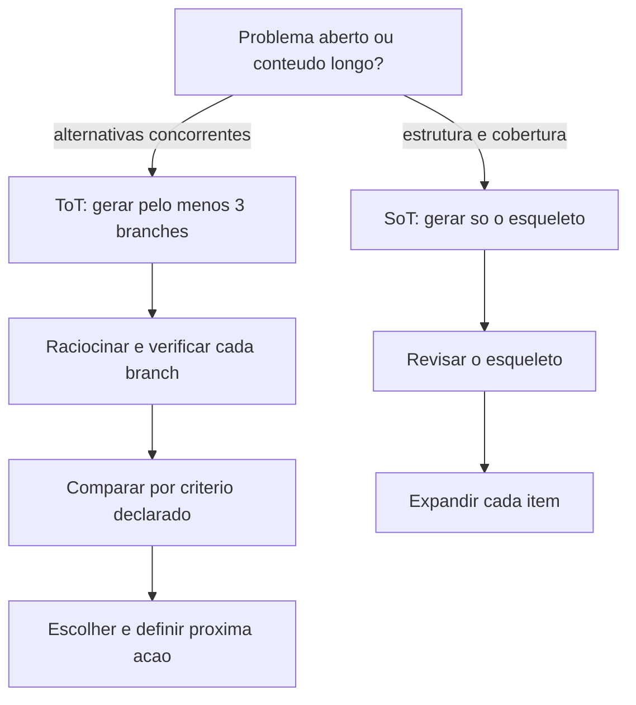

# Tree of Thought e Skeleton of Thought

> [!summary] TL;DR
> - ToT abre vários ramos de análise, aprofunda sub-ramos e compara alternativas por um critério declarado antes de concluir; serve para problemas abertos (diagnóstico, arquitetura, planejamento, trade-offs).
> - Sem critério explícito (plausibilidade, custo, escalabilidade, risco, simplicidade operacional) a árvore vira "verbosidade organizada".
> - SoT trabalha em duas fases: primeiro o esqueleto de tópicos/seções, depois a expansão de cada parte; impõe estrutura, não explora alternativas.
> - Esqueleto ruim contamina e amplifica erros na expansão; controlar a separação de fases com "Do not expand yet".
> - CoT e ToT exploram raciocínio e alternativas; SoT consolida a solução em sequência implementável (documentação, design, implementação).

## Conceitos-chave

- **Tree of Thought (ToT)**: estrutura de branches em que branch = hipótese/direção e sub-branch = como se sustenta, como testar, consequências. Guia do repositório: exploração complexa (estratégia, planejamento), alta complexidade.
- **ToT vs self-consistency**: [[Chain of Thought e Self-Consistency]] repete a tarefa e consolida a resposta mais recorrente; ToT explora alternativas explicitamente e escolhe por critério.
- **Anatomia do prompt ToT**: papel (senior software engineer, ver [[Role Prompting]]) + problema + número mínimo de hipóteses (>= 3) + exigência de verificação + regra de seleção final + próxima ação.
- **Exemplo de debug**: endpoint `/users` lento (5 s), ramos banco de dados, network e cache, com priorização da hipótese mais plausível e próxima ação.
- **Exemplo de arquitetura**: milhões de imagens/dia, serverless vs microservices com containers vs monólito escalável em cloud, avaliados por escalabilidade, custo e complexidade.
- **Saída enxuta em produção**: pedir só "Final Answer" (a árvore orienta, a saída fica curta); para depuração/brainstorming pedir a comparação completa. O custo depende também do output e da estrutura pedida, não só do input (ver [[Custo, Latência e Escala de Prompts]]).
- **Skeleton of Thought (SoT)**: o esqueleto é artefato de planejamento (blocos, ordem, escopo); pode nem ser exibido ao usuário final, mas o modelo "ver" a estrutura melhora coerência e cobertura. Guia do repositório: conteúdo longo (ensaios, documentação).
- **Por que SoT em documentação**: documentação falha mais por desorganização que por falta de conteúdo; esqueleto explícito dá previsibilidade estrutural (ligado à [[Estrutura de Prompts]]).
- **Exemplos de SoT**:
  - Otimização de SQL (Senior Backend Engineer, 3 a 5 bullets: indexação, evitar SELECT *, otimizar JOINs, reestruturar queries, plano de execução); a expansão com exemplos vira checklist de revisão.
  - ADR PostgreSQL vs MongoDB com seções Context, Decision, Alternatives Considered, Consequences, References (só headers primeiro, depois conteúdo).
  - CRUD de produtos em Go: structs, go-chi ou net/http, rotas, handlers, validação com go-playground, PostgreSQL, error handling, pacotes (handlers, models, db).
- **Least-to-Most (técnica relacionada do repositório)**: decompor o problema em subproblemas como to-do list com checkboxes, resolver um a um marcando [x] e combinar no design final; indicado para problemas decomponíveis (algorítmicos), parecido com programação dinâmica.

## Fluxograma / Processo



## Erros comuns / Cuidados

- ToT gera mais verbosidade, tokens e latência.
- Branches podem não ser realmente diversos (mesma intuição com palavras diferentes); prompts vagos geram árvores pobres.
- SoT não corrige falta de contexto nem substitui julgamento técnico; esqueleto errado é amplificado.
- SoT tem custo extra de tokens e risco do modelo ignorar a separação de fases e detalhar cedo demais.

## Materiais complementares

### Prompts

**ToT: debug de latência (4-ToT.py, gpt-4o)**
```text
You are a senior software engineer. 
A user reports that an API request to the endpoint `/users` is taking 5 seconds to respond, which is too slow. 
Think in a Tree of Thought manner: 
- Generate at least 3 different possible causes for this latency. 
- For each cause, reason step by step about how likely it is and how you would verify it. 
- Then compare the branches and choose the most plausible one as the primary hypothesis. 
- Finish with a recommended next action to debug or fix the issue.
```

**ToT: escolha de arquitetura com comparação completa (4-ToT.py)**
```text
You are designing a service that processes millions of images daily. 
Think in a Tree of Thought manner: 
- Generate at least 3 different architecture options. 
- For each option, reason step by step about scalability, cost, and complexity. 
- Compare the options. 
- Choose the best trade-off and explain why it is superior to the others.
- Finish with "Final Answer: " + the chosen option.
```

**ToT: variante que devolve só a resposta final (4-ToT.py)**
```text
You are designing a service that processes millions of images daily. 
Think in a Tree of Thought manner: 
- Think about at least 3 different architecture options. 
- For each option, reason step by step about scalability, cost, and complexity. 
- Compare the options. 
- Choose the best trade-off and explain why it is superior to the others.
- Finish with "Final Answer: " + the chosen option with 6 words or less.

- OUTPUT ONLY THE FINAL ANSWER, WITHOUT ANY OTHER TEXT.
```

**SoT: otimização de SQL (5-SoT.py, gpt-4o)**
```text
You are a senior backend engineer. A junior developer asked you how to optimize SQL queries for better performance. 
Follow the Skeleton of Thought approach: 

Step 1: Generate only the skeleton of your answer in 3–5 concise bullet points. 
Step 2: Expand each bullet point into a clear and detailed explanation with examples. 
Make sure the final answer is structured and easy to follow.
```

**SoT: ADR PostgreSQL vs MongoDB (5-SoT.py)**
```text
You are a software architect. I want you to produce an Architecture Decision Record (ADR) about choosing PostgreSQL instead of MongoDB. 

Follow the Skeleton of Thought approach:
Step 1: First, output only the skeleton of the ADR as section headers (no explanations yet). 
Use the standard ADR structure with 5 sections: Context, Decision, Alternatives Considered, Consequences, References. 
Step 2: After showing the skeleton, expand each section with clear and detailed content. 
Keep the final ADR professional, structured, and easy to read.
```

**SoT: planejamento de API REST de produtos em Go (5-SoT.py)**
```text
You are a senior Go developer. I want you to help me plan a REST API for managing products in Go.

Follow the Skeleton of Thought approach:

Step 1: Output only the skeleton of the solution in 6–8 concise bullet points. 
The skeleton must cover: data model definition in Go (structs), choice of HTTP framework or net/http, routing, handlers, validations, database layer, error handling, and project structure. Do not expand yet.

Step 2: Expand each bullet point with clear technical details, examples, and Go best practices. 
Include sample code snippets in Go (structs, handlers, routes) and considerations about packages (e.g., chi, or net/http), error handling with idiomatic Go, and how to organize the project into packages (handlers, models, db). 
Use concise and professional language.

The API must implement CRUD operations for products with fields: id, name, description, price, stock.
```

**Least-to-Most: encurtador de URL em Go (8-Least-to-most.py, gpt-5-mini)**
```text
You are a senior Go backend engineer.

Problem: We need to design a URL shortener service in Go.

Use the Least-to-Most Prompting method:
1. Start by listing the subproblems that need to be solved as a to-do list. Use markdown checkboxes: [ ] for pending, [x] for completed.
2. As you solve each subproblem, update the to-do list by marking it as [x] and write the solution right below it.
3. Continue until all items are solved.
4. At the end, combine all the solutions into a final integrated design for the URL shortener.

Constraints:
- Service must be implemented in Go.
- Short URLs must be unique and easy to generate.
- Must support endpoints: shorten a URL, retrieve the original URL.
- Use an in-memory store at first, but mention how it could scale with a database.
- Include minimal validation and error handling.
- Keep explanations concise and structured.

Output format:
- To-do list with checkboxes (updating as you progress)
- Each solved subproblem explained with reasoning and minimal Go code snippets
- Final combined design
```

### Conteúdo extra

- Repositório: https://github.com/devfullcycle/mba-ia-prompt-engineering (pasta `1-tipos-de-prompts/`, scripts `4-ToT.py`, `5-SoT.py` e `8-Least-to-most.py`).

## Tags de busca

`#prompt-engineering` `#tree-of-thought` `#skeleton-of-thought` `#least-to-most` `#adr`
