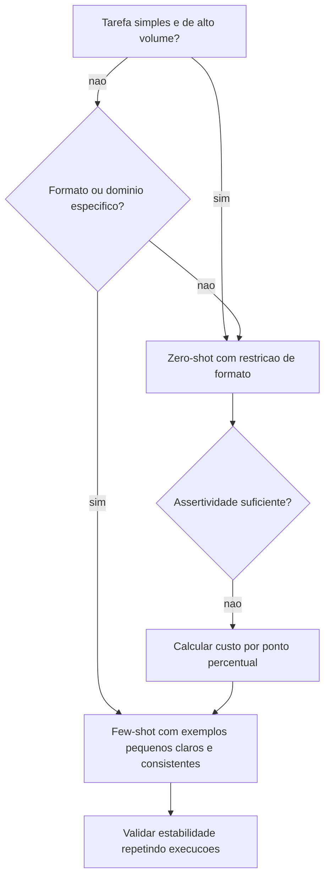

# Zero-shot, One-shot e Few-shot

> [!summary] TL;DR
> - Zero-shot: só a tarefa, sem demonstrações; padrão para tarefas simples, bem definidas e de alto volume (menos tokens, custo e latência).
> - One-shot/few-shot: 1 ou poucos pares entrada/saída que ensinam conteúdo e estrutura exata da resposta; usar quando o formato importa tanto quanto o conteúdo.
> - Few-shot não treina o modelo, condiciona a resposta no contexto, e cada exemplo ocupa tokens.
> - Mais exemplos não melhoram de forma monotônica: exemplos conflitantes geram instabilidade entre execuções.
> - Decisão entre os dois é conta: custo por ponto percentual de assertividade versus o custo do erro evitado.

## Conceitos-chave

- **Zero-shot**: prompt sem exemplos de entrada/saída; o tamanho do prompt não importa, importa a ausência de demonstrações.
- **Bons usos de zero-shot**: resumir parágrafo, traduzir frase, pergunta factual, esqueleto inicial de API, validar JSON, identificar elementos de frase; alto volume (milhões de requisições), em linha com [[Custo, Latência e Escala de Prompts]].
- **Limites de zero-shot**: raciocínio elaborado, precisão procedural, padronização forte; menos controle de formato; sensível ao wording; não elimina [[Alucinação em LLMs]].
- **Restrição de formato em zero-shot**: "Respond only with the city name" ajuda, mas não tem a rigidez de few-shot ou de schema.
- **Detecção de intenção**: inferir o objetivo implícito do usuário em zero-shot; útil para decidir filtros, rotas, consultas e o que recuperar em RAG (ligado a [[Query Reformulation e Prompt Enrichment]]).
- **Comparação entre modelos (capital do Brasil)**:
  - GPT-3.5 Turbo: "Brasília" mínimo.
  - GPT-4: tende a frase completa.
  - GPT-5 nano (reasoning): usa reasoning interno mesmo em prompt trivial, mais de uma centena de tokens para a mesma saída "Brasília" (custo oculto e latência).
- **One-shot/few-shot**: orientar por demonstração; o exemplo codifica explicitamente o padrão de resposta ("dado X, retorne Y"); "França: Paris" induz "Brasília" enxuto.
- **Bons usos de few-shot**: domínio específico, classificação, saída estruturada, padronizar e-mails, casos de teste semelhantes, resumos no mesmo estilo, quiz, documentação de API.
- **Few-shot certo/errado**: pares concretos do que fazer e do que não fazer (import errado vs import certo) viram instrução permanente na [[Estrutura de Prompts]].
- **Few-shot por categoria**: exemplos por categoria (segurança, performance, N+1, verbosidade, nomes inadequados) calibram a política de decisão de um prompt de code review e deslocam o perfil de erro medido em [[Precision, Recall e F1]].
- **Experimentos de classificação de log**:
  - One-shot ("Database connection lost" -> ERROR, classificar "Disk usage at 85%"): pode devolver algo inesperado como "status".
  - 4 exemplos coerentes: "API response time is above threshold" vira WARNING por analogia.
  - 15 exemplos com ambíguos (Disk usage 90% -> ERROR, Low disk space 5% -> ERROR, timeout -> WARNING): "CPU usage is 95%" oscila entre WARNING e ERROR entre execuções.
- **Custo**: cada exemplo ocupa janela, tokens e latência (ver [[Gestão de Context Window em Prompts]]).
- **Conta de trade-off**: zero-shot 86% de assertividade a US$ 10 mil/mês; few-shot 90% a US$ 12 mil/mês (20% mais caro); 4 p.p. por US$ 2 mil = US$ 500 por ponto percentual; pagar só se o erro evitado valer isso. Se há mitigação, aceitar mais erro pode ser racional; em tarefas sensíveis até 90% pode ser insuficiente.

## Fluxograma / Processo



## Erros comuns / Cuidados

- Avaliar só acerto: medir também aderência ao formato, estilo, tempo de resposta e custo.
- Usar modelo reasoning em tarefas triviais e massivas: pode ser economicamente inadequado.
- Exemplos rígidos ou pouco representativos enviesam e reduzem generalização e criatividade.
- Exemplos conflitantes são perigosos quando a classificação aciona automação (ex: abrir issue no GitHub só em caso de erro); preferir conjunto pequeno, claro e consistente, com curadoria rigorosa em cenários sensíveis.
- Utilidade marginal de cada exemplo cai: menos exemplos pode ser melhor.

## Materiais complementares

### Prompts

**Zero-shot: pergunta direta (1-zero-shot.py, gpt-3.5-turbo)**
```text
What's Brazil's capital?
```

**Zero-shot: extração de intenção (1-zero-shot.py)**
```text
Find the user intent in the following text: 
I'm looking for a restaurant around São Paulo who has a good rating for Japanese food.
```

**Zero-shot: restrição de formato (1-zero-shot.py)**
```text
What's Brazil's capital? Respond only with the city name.
```

**One-shot: pergunta factual (2-one-few-shot.py)**
```text
EXAMPLE:
Question: What's France's capital?
Response: Paris

Question: What's Brazil's capital?
Response: 
```

**One-shot: classificação de log (2-one-few-shot.py)**
```text
Example:
Input: "Database connection lost at 10:34."
Output: ERROR

Now classify:
Input: "Disk usage at 85%."
Output:
```

**Few-shot coerente com 4 exemplos (2-one-few-shot.py)**
```text
Classify the log severity.

Example 1:
Input: "Database connection lost at 10:34."
Output: ERROR  

Example 2:
Input: "Disk usage at 85%."
Output: WARNING

Example 3:
Input: "Database response time is above the threshold at 30ms"
Output: WARNING  

Example 4:
Input: "User logged in successfully."
Output: INFO  

Now classify:
Input: "API response time is above threshold."
Output:
```

**Few-shot com 15 exemplos, alguns ambíguos: situação crítica de instabilidade (2-one-few-shot.py)**
```text
Classify the log severity.

Example 1:
Input: "Database connection lost at 10:34."
Output: ERROR  

Example 2:
Input: "Disk usage at 85%."
Output: WARNING  

Example 3:
Input: "User logged in successfully."
Output: INFO  

Example 4:
Input: "File not found: config.yaml"
Output: ERROR  

Example 5:
Input: "High memory usage detected: 75%"
Output: WARNING  

Example 6:
Input: "Background job finished"
Output: INFO  

Example 7:
Input: "Retrying request to payment gateway"
Output: ERROR  

Example 8:
Input: "Disk usage at 90%"
Output: ERROR   // ambíguo: poderia ser WARNING  

Example 9:
Input: "API latency is above threshold"
Output: WARNING  

Example 10:
Input: "Scheduled backup completed"
Output: INFO  

Example 11:
Input: "Low disk space: 15% left"
Output: WARNING  

Example 12:
Input: "Low disk space: 5% left"
Output: ERROR   // ambíguo: WARNING ou ERROR?  

Example 13:
Input: "Cache warming completed"
Output: INFO  

Example 14:
Input: "Connection timeout, retrying..."
Output: WARNING   // ambíguo: poderia ser ERROR  

Example 15:
Input: "Authentication failed for user admin"
Output: ERROR  

Now classify:
Input: "CPU usage is 95%."
Output:
```

### Conteúdo extra

- Repositório: https://github.com/devfullcycle/mba-ia-prompt-engineering (pasta `1-tipos-de-prompts/`, scripts `1-zero-shot.py` e `2-one-few-shot.py`).
- Boa prática do AGENTS.md do capítulo: começar simples (zero-shot) e só adicionar complexidade se precisar; few-shot para formato; temperatura 0 para consistência.

## Tags de busca

`#prompt-engineering` `#zero-shot` `#few-shot` `#classificacao-de-logs` `#custo-de-tokens`
